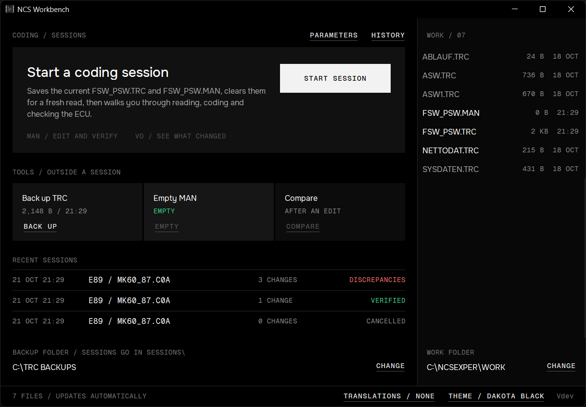

<p align="center">
  
</p>

<h1 align="center">NCS Workbench</h1>

<p align="center">
  <a href="https://github.com/ak-tr/NCS-Workbench/actions/workflows/build.yml"></a>
  <a href="https://github.com/ak-tr/NCS-Workbench/releases/latest"></a>
  
</p>

A small, portable Windows helper for BMW NCS Expert coding. It watches the files NCS Expert writes to `C:\NCSEXPER\WORK` and takes care of the routine around coding: preparing the WORK folder, keeping a copy of every trace and MAN file, comparing your edits before you code and checking the result after.

> [!NOTE]
> Workbench is a companion to NCS Expert and NCS Dummy, not a replacement. It doesn't talk to the car or edit coding; it manages the files the two tools exchange. It assumes you already know both tools and their workflows, and doesn't teach them.

One self-contained `NCS-Workbench.exe`, no installer, no runtimes. Runs on Windows XP (32-bit) through Windows 11, including XP virtual machines.



## Features

### Guided coding sessions

**START SESSION** walks you through a whole coding job. NCS Expert reads and codes, NCS Dummy edits, and Workbench handles everything in between:

1. **Prepare:** saves `FSW_PSW.TRC` and `FSW_PSW.MAN` to a new session folder, then clears them for a fresh read.
2. **Read the ECU:** picks up the new trace from NCS Expert on its own; you confirm which ECU it was.
3. **Edit in NCS Dummy:** opens NCS Dummy on a copy it can read the chassis and module from, and saves every MAN you export.
4. **Review:** shows what the MAN will change, and flags anything odd in the files.
5. **Code:** a checklist for `SG_CODIEREN` in NCS Expert. You confirm when coding is done.
6. **Read back:** read the ECU again; each change shows as **MATCH**, **MISMATCH** or **CAN'T VERIFY**.
7. **Finish:** record the outcome. It can't contradict the read-back.

Nothing in WORK is deleted or emptied before its copy is saved and checked, and only `FSW_PSW.TRC` and `FSW_PSW.MAN` are ever touched. Workbench never talks to the car. Every session's files and record stay in your backup folder, browsable in **HISTORY**, and a session interrupted by a crash or a closed window can be resumed.

### Tools

Outside a session, three manual tools do one job each:

- **Back up the TRC** as `CHASSIS-MODULE-YYYYMMDD-HHMM-FSW_PSW.TRC`, the name NCS Dummy reads the chassis and module from. With SP-Daten installed (`C:\NCSEXPER\DATEN`), the module is detected from the trace.
- **Empty the MAN** for a fresh edit, backing it up first.
- **Compare TRC with MAN** function by function, with a live count of changes.

## Guides

- [Guided coding sessions](docs/guides/guided-sessions.md): every step of a session with screenshots, what can go wrong at each one, the history window and what's saved.
- [Main window and tools](docs/guides/main-window.md): the home screen, the WORK folder panel and the three manual tools.
- [Themes](docs/guides/themes.md): the five colour schemes (dark, dim and light) and how to switch between them.

## Download

Get `NCS-Workbench.exe` from the [Releases](../../releases) page and run it from anywhere, including a USB stick. Each release also has a zip with the font licences and a `SHA256SUMS.txt` to check the download.

## Usage

- **WORK folder:** defaults to `C:\NCSEXPER\WORK`. Change it with **CHANGE** under the file list.
- **Backup folder:** there's no default. You're asked to choose one the first time a backup or session needs it, and you can change it at any time. Sessions go in its `Sessions` folder.
- **NCS Dummy:** you're asked for `NcsDummy.exe` the first time you click **OPEN NCS DUMMY**.
- **Typical job:** click **START SESSION** and follow the steps. Without a session: read the module in NCS Expert, back up the TRC, empty the MAN, edit in NCS Dummy, compare, then code from NCS Expert.

### Settings

Settings are stored per user in the registry under `HKEY_CURRENT_USER\Software\NCS Workbench`. The key is created on the first change, so just running the app leaves nothing behind. To reset, delete that key. Sessions aren't settings: they stay in the backup folder.

## Building

Requirements:

- Windows
- [llvm-mingw](https://github.com/mstorsjo/llvm-mingw/releases), **msvcrt** variant (`llvm-mingw-<version>-msvcrt-x86_64.zip`). CI uses 20261006. The UCRT variant produces binaries that won't start on XP or a clean Windows 7.

Extract the toolchain to `%LOCALAPPDATA%\llvm-mingw` or put its `bin` folder on `PATH`, then:

```bat
build.cmd
test.cmd
```

`build.cmd` writes `build\NCS-Workbench.exe` and fails if the exe imports anything that won't load on XP (UCRT DLLs or Vista-only kernel32 functions). `test.cmd` builds and runs the tests: the TRC/MAN parser against the real files in `samples/`, the SP-Daten parser against small files the test builds itself (SP-Daten is BMW's data and isn't in the repo), and whole guided sessions on a mock WORK folder in `%TEMP%`: locked files, half-written traces, repeated exports, read-back mismatches and restarts.

## Releasing

GitHub Actions (`.github/workflows/build.yml`) builds and tests every push and pull request, and uploads the exe as a workflow artifact. Pushing a version tag also publishes a release:

```bat
git tag v1.0.0
git push origin v1.0.0
```

The tag's version is stamped into the exe's version info and shown in the window footer.

## Project layout

```
src/            Win32 app (C++17, raw Win32 API, XP-era APIs only)
src/trace.h     TRC/MAN parser, checks, diff and read-back verification (no Windows headers)
src/session.*   guided session: state machine, snapshots, WORK changes (no UI)
src/ncsdata.h   SP-Daten file parser (no Windows headers)
test/           parser, diff and session tests (the session tests use a mock WORK folder)
docs/guides/    user guides; screenshots in docs/screenshots/
samples/        real FSW_PSW.TRC / FSW_PSW.MAN files used by the tests
fonts/          embedded Onest and Geist Mono fonts with their licences
tools/          icon generator
```

## Credits

- UI fonts: [Onest](https://github.com/simpals/onest) and [Geist Mono](https://github.com/vercel/geist-font), both under the SIL Open Font License 1.1 (see `fonts/`).
- Visual style based on the "Mosaic" design guide from [akif.kr](https://github.com/ak-tr/akif.kr).

## License

Copyright (c) 2026 ak-tr.

NCS Workbench is licensed under the [GNU General Public License v3.0](LICENSE) (GPL-3.0-only). You may use, modify and redistribute it, including commercially, under those terms. Distributed modified versions must remain GPL-licensed, and binary distributions must provide corresponding source as required by the GPL. The software comes without warranty.

The bundled Onest and Geist Mono fonts remain under the SIL Open Font License 1.1; see their notices in [fonts/](fonts/).

## Disclaimer

Not affiliated with or endorsed by BMW AG. BMW and NCS Expert are trademarks of their respective owners. Coding a vehicle's control units carries risk. Keep backups and use at your own risk.
