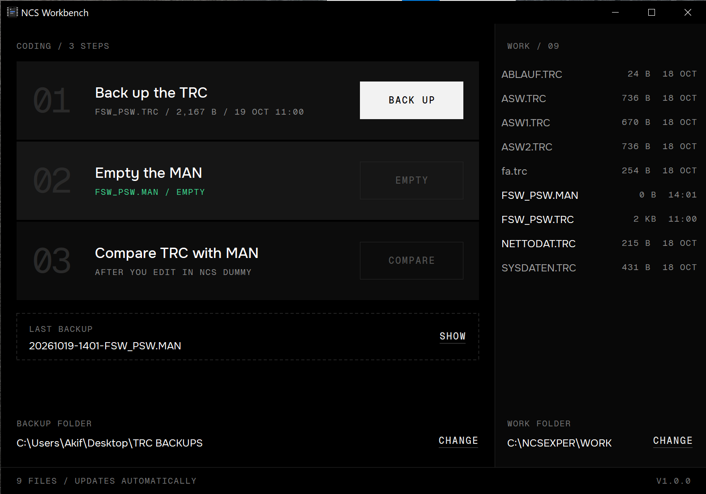
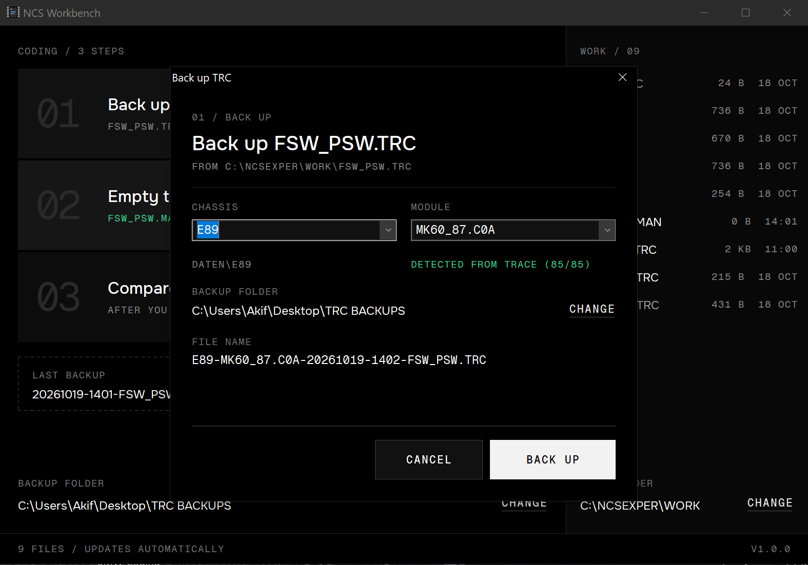
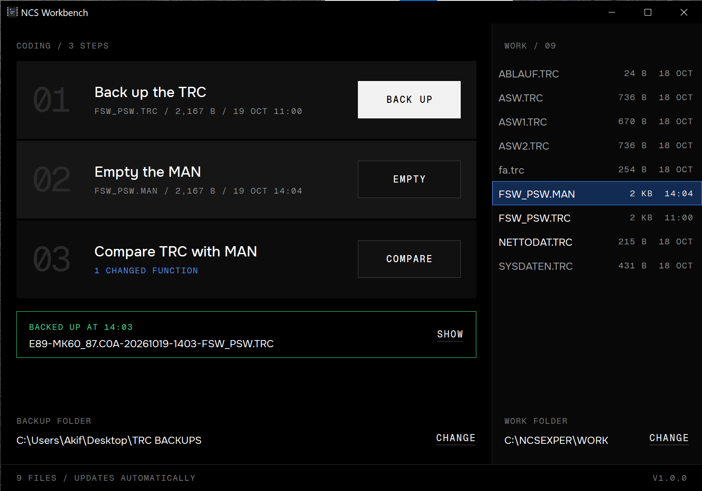
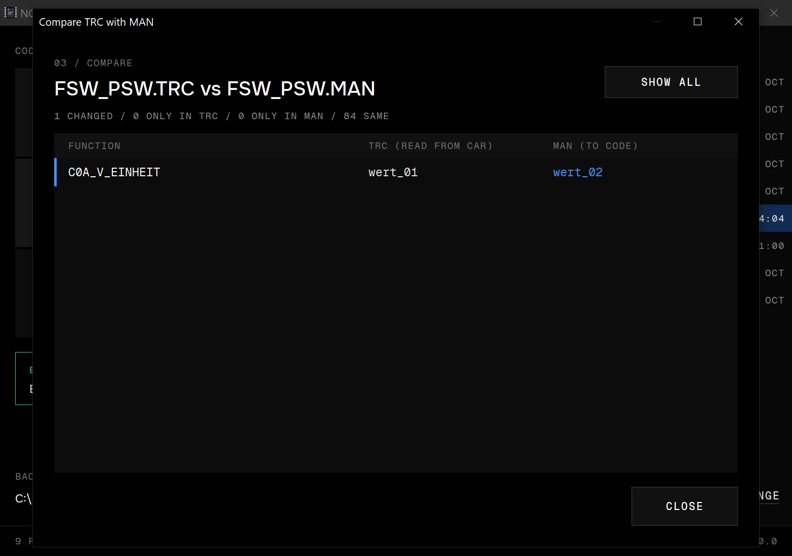
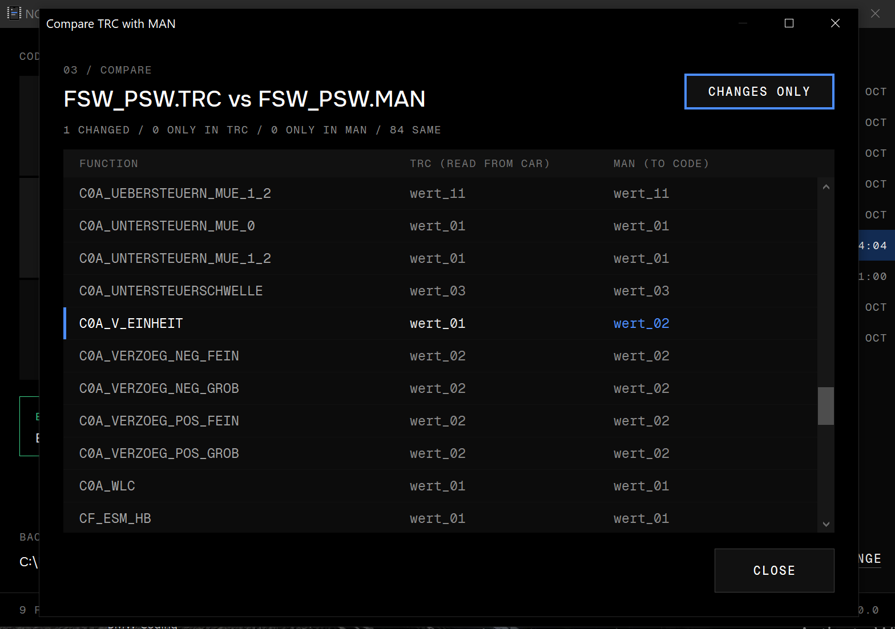

<p align="center">
  
</p>

<h1 align="center">NCS Workbench</h1>

<p align="center">
  <a href="https://github.com/ak-tr/NCS-Workbench/actions/workflows/build.yml"></a>
  <a href="https://github.com/ak-tr/NCS-Workbench/releases/latest"></a>
  
</p>

A small, portable Windows helper for BMW NCS Expert coding. It watches the files NCS Expert writes to `C:\NCSEXPER\WORK` and takes care of the routine around a coding session: backing up the trace, emptying the MAN file and comparing your edits before you code the car.

One self-contained `NCS-Workbench.exe`, no installer, no runtimes. Runs on Windows XP (32-bit) through Windows 11, including XP virtual machines.

## Features

### Guided coding sessions

Click **START SESSION** and Workbench walks you through a whole coding job, with NCS Expert doing the reading and coding and NCS Dummy the editing:

1. **Prepare.** Workbench shows what will happen, saves `FSW_PSW.TRC` and `FSW_PSW.MAN` to a new session folder, then deletes the TRC and empties the MAN. Nothing else in WORK is touched, and nothing is changed before its copy is saved. If the TRC in WORK is a read you just made, you can use it as the first read instead.
2. **Read the ECU.** Run `CODIERDATEN_LESEN` in NCS Expert. The new trace is picked up on its own once NCS Expert has finished writing it, then you confirm the chassis and module (suggested from SP-Daten when it's installed).
3. **Edit in NCS Dummy.** **OPEN NCS DUMMY** starts it; open the session's `CHASSIS-MODULE-...-FSW_PSW.TRC` copy, change what you want and export `FSW_PSW.MAN` to WORK. Every export is saved.
4. **Review.** The changes the MAN makes, function by function. Odd lines, duplicates or unreadable files are flagged, with the raw files a click away.
5. **Code.** A checklist for NCS Expert (`SG_CODIEREN`). Workbench never talks to the car: you click **I HAVE CODED** when NCS Expert is done. If the MAN in WORK changed since the review, you review it again first.
6. **Read back.** Workbench saves and clears WORK again; read the ECU once more and every change shows as **MATCH**, **MISMATCH** or **CAN'T VERIFY**. A match means the ECU holds the value, not that the feature works.
7. **Finish.** Mark the outcome (it can't contradict the read-back), and optionally empty a MAN left in WORK.

Every session keeps its files and a `session.ini` record in `Sessions\` inside your backup folder. **HISTORY** lists them with their changes and read-back results, opens the saved files and exports a session's folder. If Workbench closes mid-session, it offers to pick up where you left off and changes nothing until you choose. Only one session at a time can use a WORK folder.

### Tools

Outside a session, the three manual tools work as before, with the WORK folder's files listed alongside and refreshed automatically.

1. **Back up the TRC.** Pick the chassis and `FSW_PSW.TRC` is copied to your backup folder as `CHASSIS-MODULE-YYYYMMDD-HHMM-FSW_PSW.TRC`, the format NCS Dummy reads the chassis and module from. With SP-Daten installed (`C:\NCSEXPER\DATEN`), the chassis list comes from it and the module is detected from the trace itself. An E91 DSC read becomes `E89-MK60_87.C0A-20261019-1012-FSW_PSW.TRC`, since the E91 shares the E89 data folder. Without SP-Daten, type both. Existing backups are never overwritten.
2. **Empty the MAN.** After a confirmation, the current `FSW_PSW.MAN` is backed up as `YYYYMMDD-HHMM-FSW_PSW.MAN`, then emptied for a fresh edit in NCS Dummy.
3. **Compare TRC with MAN.** A table of `Function | TRC | MAN`, matched by function name, shows exactly what will change when you code. Changed functions and functions found in only one file are highlighted. The step's status line keeps a live count of changes.

## Download

Get `NCS-Workbench.exe` from the [Releases](../../releases) page and run it from anywhere, including a USB stick. Each release also has a zip with the font licences and a `SHA256SUMS.txt` to check the download.

## Usage

- **WORK folder:** defaults to `C:\NCSEXPER\WORK`. Change it with **CHANGE** under the file list.
- **Backup folder:** there's no default. You're asked to choose one the first time a backup or session needs it, and you can change it at any time. Sessions go in its `Sessions` folder.
- **NCS Dummy:** you're asked for `NcsDummy.exe` the first time you click **OPEN NCS DUMMY**; **CHANGE** in step 03 picks another.
- **Typical session:** **START SESSION** and follow the steps. Without a session: read the module in NCS Expert, back up the TRC, empty the MAN, edit in NCS Dummy, compare, then code from NCS Expert.

### Settings

Settings are stored per user in the registry under `HKEY_CURRENT_USER\Software\NCS Workbench`. The key is created on the first change, so just running the app leaves nothing behind. To reset, delete that key.

## UI walkthrough

These screenshots show the manual tools from before guided sessions, when they were the home screen's three steps. They now sit under **TOOLS** on the home screen and work the same.

### 1. First launch

The home screen shows the three coding steps and the files in the WORK folder. Here, the TRC is ready to back up and the MAN file is empty.



### 2. Back up the TRC

Click **BACK UP** to review the chassis, detected module, backup folder and generated filename before saving the trace.



### 3. Backup complete

The home screen confirms the backup with a green status panel. Click **SHOW** to locate the saved file.


### 4. MAN change detected

After editing and saving the MAN file in NCS Dummy, the home screen updates automatically. The comparison status shows one changed function and **COMPARE** becomes available.



### 5. Compare changes only

Click **COMPARE** to review the differences between the TRC read from the car and the MAN prepared for coding. In this example, `C0A_V_EINHEIT` changes from `wert_01` to `wert_02`.



### 6. Show all functions

Click **SHOW ALL** to include unchanged functions for context. Changed values remain highlighted; click **CHANGES ONLY** to return to the filtered view.



## Building

Requirements:

- Windows
- [llvm-mingw](https://github.com/mstorsjo/llvm-mingw/releases), **msvcrt** variant (`llvm-mingw-<version>-msvcrt-x86_64.zip`). CI uses 20261006. The UCRT variant produces binaries that won't start on XP or a clean Windows 7.

Extract the toolchain to `%LOCALAPPDATA%\llvm-mingw` or put its `bin` folder on `PATH`, then:

```bat
build.cmd
test.cmd
```

`build.cmd` writes `build\NCS-Workbench.exe` and fails if the exe imports anything that won't load on XP (UCRT DLLs or Vista-only kernel32 functions). `test.cmd` builds and runs the tests: the TRC/MAN parser against the real files in `samples/`, the SP-Daten parser against small files the test builds itself (SP-Daten is BMW's data and isn't in the repo), and whole guided sessions on a mock WORK folder in `%TEMP%`: locked files, half-written traces, repeated exports, read-back mismatches and restarts.

## Releasing

GitHub Actions (`.github/workflows/build.yml`) builds and tests every push and pull request, and uploads the exe as a workflow artifact. Pushing a version tag also publishes a release:

```bat
git tag v1.0.0
git push origin v1.0.0
```

The tag's version is stamped into the exe's version info and shown in the window footer.

## Project layout

```
src/            Win32 app (C++17, raw Win32 API, XP-era APIs only)
src/trace.h     TRC/MAN parser, checks, diff and read-back verification (no Windows headers)
src/session.*   guided session: state machine, snapshots, WORK changes (no UI)
src/ncsdata.h   SP-Daten file parser (no Windows headers)
test/           parser, diff and session tests (the session tests use a mock WORK folder)
samples/        real FSW_PSW.TRC / FSW_PSW.MAN files used by the tests
fonts/          embedded Onest and Geist Mono fonts with their licences
tools/          icon generator
```

## Credits

- UI fonts: [Onest](https://github.com/simpals/onest) and [Geist Mono](https://github.com/vercel/geist-font), both under the SIL Open Font License 1.1 (see `fonts/`).
- Visual style based on the "Mosaic" design guide from [akif.kr](https://github.com/ak-tr/akif.kr).

## License

Copyright (c) 2026 ak-tr.

NCS Workbench is licensed under the [GNU General Public License v3.0](LICENSE) (GPL-3.0-only). You may use, modify and redistribute it, including commercially, under those terms. Distributed modified versions must remain GPL-licensed, and binary distributions must provide corresponding source as required by the GPL. The software comes without warranty.

The bundled Onest and Geist Mono fonts remain under the SIL Open Font License 1.1; see their notices in [fonts/](fonts/).

## Disclaimer

Not affiliated with or endorsed by BMW AG. BMW and NCS Expert are trademarks of their respective owners. Coding a vehicle's control units carries risk. Keep backups and use at your own risk.
