# Guided coding sessions

A guided session takes one coding job from start to finish: NCS Expert reads, Workbench captures, NCS Dummy edits, Workbench reviews, NCS Expert codes, Workbench verifies. Workbench never talks to the car and never edits coding itself. It prepares the WORK folder, keeps a copy of every file involved, compares them and keeps a record you can look at later.

The screenshots were taken on a test setup: the sample trace from `samples/`, a made-up SP-Daten folder and `C:\TRC BACKUPS` as the backup folder. For the rest of the window and the manual tools, see [Main window and tools](main-window.md).

## Before you start

- **Backup folder.** Sessions are saved in its `Sessions` folder. If none is set, you're asked for one when you start your first session.
- **NCS Dummy.** You're asked for `NcsDummy.exe` the first time you click **OPEN NCS DUMMY**. You can also open NCS Dummy yourself.
- **SP-Daten** (`C:\NCSEXPER\DATEN`) is optional. With it, the chassis list comes from SP-Daten and the module is suggested from the trace.

## The home screen


**START SESSION** begins. **RECENT SESSIONS** shows the last three with their result; **HISTORY** shows them all.

## 01 Prepare WORK

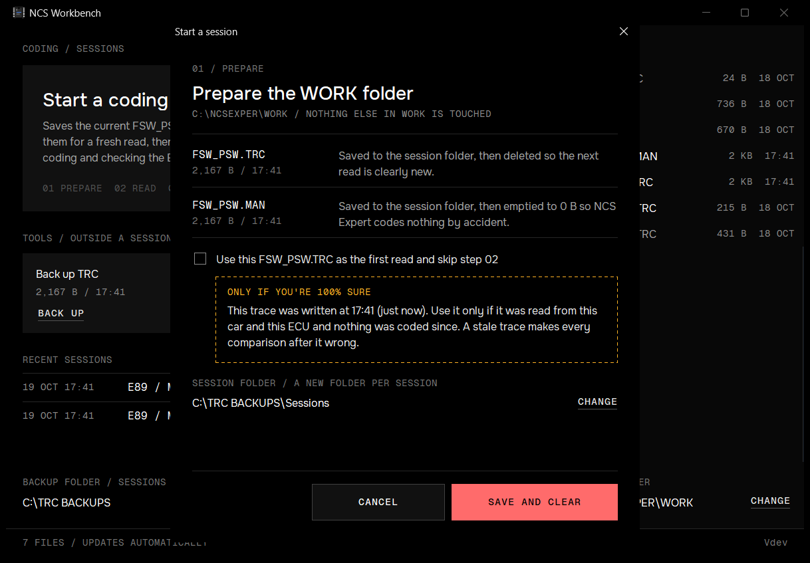

Before anything changes, the dialog lists what will happen to the two files:

- `FSW_PSW.TRC` is saved to the session folder, then **deleted**, so the next read is clearly a new one.
- `FSW_PSW.MAN` is saved, then **emptied**, so NCS Expert codes nothing by accident. If there's no MAN, an empty one is created.

Nothing else in WORK is touched. **SAVE AND CLEAR** is red because it changes files, and **CANCEL** has the focus. If neither file has anything to clear, the button is **START** instead.

**Use this FSW_PSW.TRC as the first read** skips the read in step 02 and keeps the TRC. Only tick it if you're sure the trace was just read from this car and this ECU and nothing was coded since. The amber box shows how old the trace is.

**CHANGE** picks another backup folder. Each session gets its own folder named after the time it started, for example `Sessions\20261019-174144`.

### If preparing fails

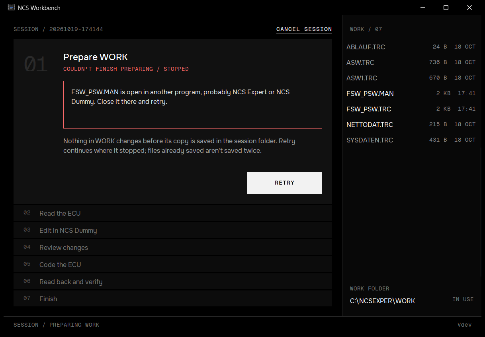

A file is only deleted or emptied once its copy is saved and read back. Right before the change, Workbench checks the file still has the content it saved. If anything goes wrong (a file open in another program, a full or read-only backup drive, a file changed mid-way), the step stops and says why. **RETRY** continues where it stopped; files already saved aren't saved again, and a file that changed meanwhile is saved again under a new name.

Also described rather than shown:

- **WORK folder not available:** START SESSION is greyed out and the tile says so.
- **Another Workbench window** already running a session on the same WORK folder: the new session is refused. Only one session can use a WORK folder at a time.

## 02 Read the ECU

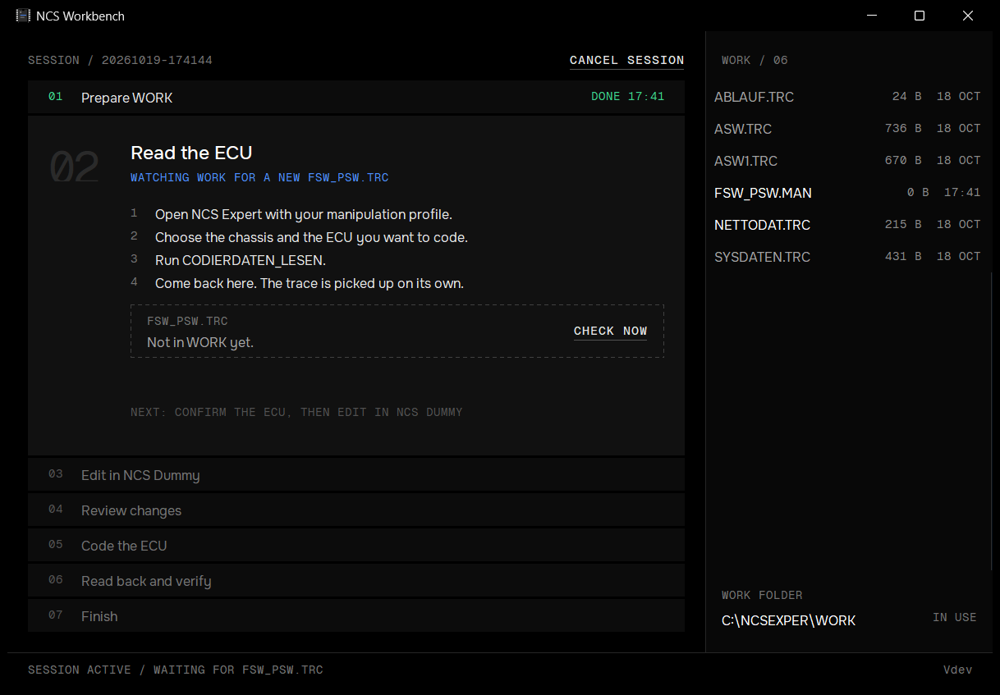

Run `CODIERDATEN_LESEN` in NCS Expert and come back. Workbench watches WORK and takes the new `FSW_PSW.TRC` on its own, once the file has stopped changing for a second and NCS Expert no longer has it open for writing. Events for the same file are only acted on once. **CHECK NOW** looks right away.

An empty file or one that isn't a readable trace isn't taken; the status line turns amber and says so. Read the ECU again.

### Which ECU was this?

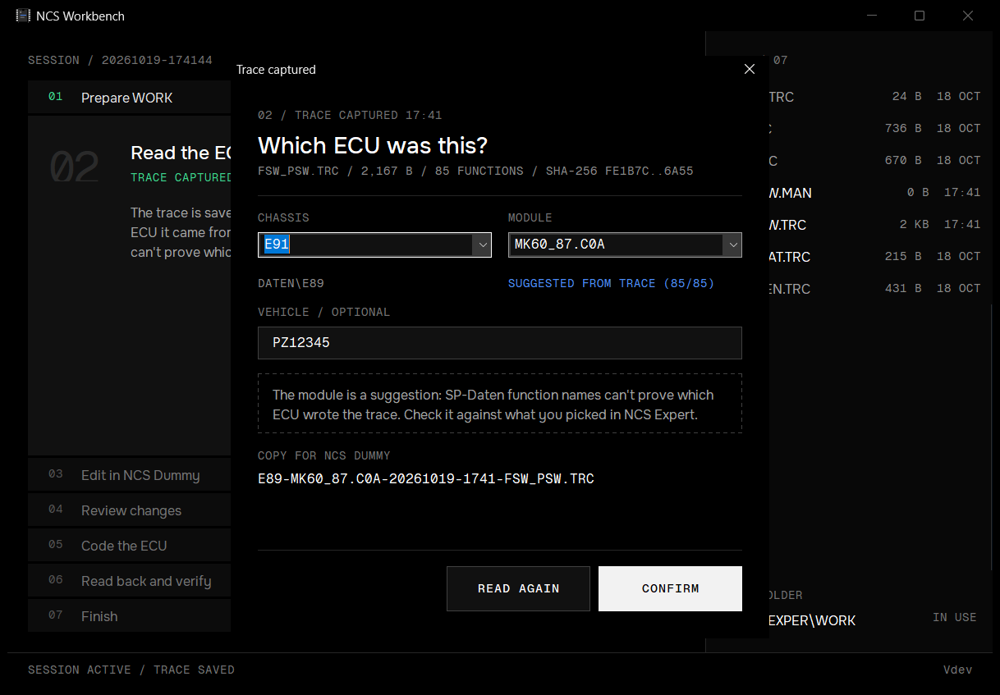

The trace doesn't say which ECU it came from, so you confirm it. With SP-Daten, the module is suggested from the trace's function names (blue: a suggestion, not a fact). **VEHICLE** is optional free text, for example the last 7 of the VIN.

**CONFIRM** saves a copy of the trace named `CHASSIS-MODULE-YYYYMMDD-HHMM-FSW_PSW.TRC` for NCS Dummy. **READ AGAIN** discards this read (its copy stays in the session folder) and waits for a new one, for when you read the wrong ECU.

If you close the dialog, the tile keeps **CONFIRM ECU** and **READ AGAIN** buttons. Without SP-Daten, type the chassis and module you picked in NCS Expert.

## 03 Edit in NCS Dummy

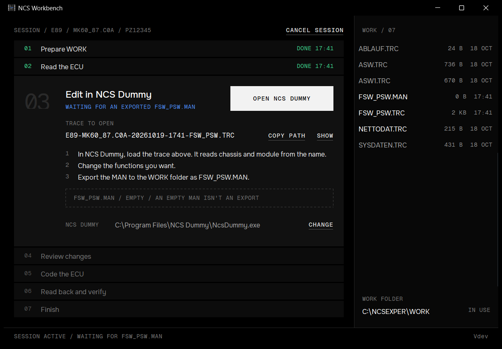

**OPEN NCS DUMMY** starts NCS Dummy. Load the trace shown under **TRACE TO OPEN**: **COPY PATH** puts its full path on the clipboard, **SHOW** opens its folder. NCS Dummy reads the chassis and module from the file name. Change what you want and export the MAN to the WORK folder as `FSW_PSW.MAN`.

Workbench takes the MAN the same way it takes a trace. An empty MAN isn't an export, so emptying it doesn't count. **CHANGE** next to the NCS Dummy path picks another program.

## 04 Review changes

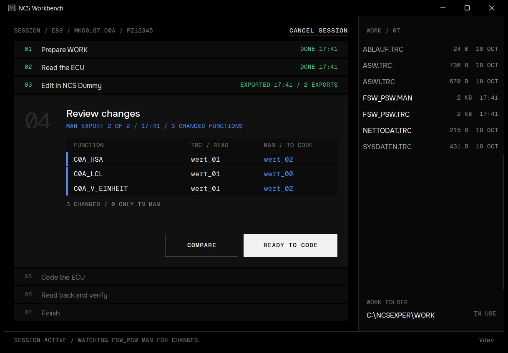

Each function the MAN changes, with the value read from the car and the value to code. Functions only in the MAN are marked amber. A MAN listing only the changed functions is normal; the summary then says **PARTIAL MAN** and the functions it leaves out aren't touched. **COMPARE** opens the full comparison.

You can export again from NCS Dummy at any time: every export is saved and the newest one is reviewed (**MAN EXPORT 2 OF 2**).

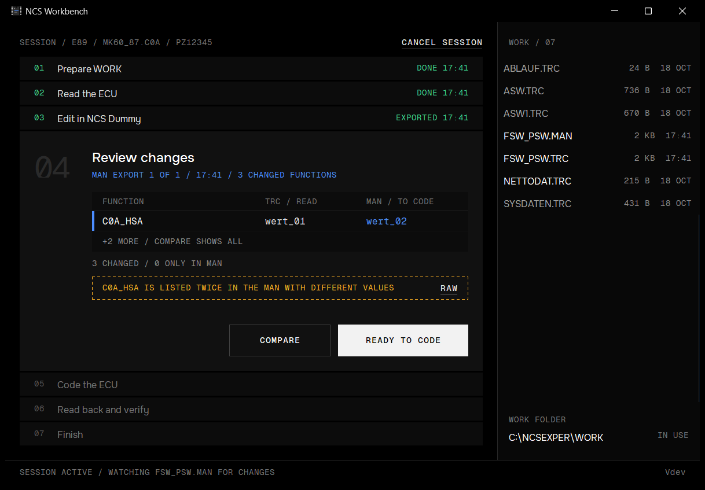

A clean parse doesn't mean the coding is valid, and nothing unexpected is skipped silently. Workbench warns about:

- values before the first function,
- functions without a value,
- names that aren't plain function names (comments?),
- functions listed twice, or listed twice with different values (as here),
- lines that aren't plain ASCII text.

**RAW** opens the saved trace and MAN in Notepad. If the MAN can't be read as functions at all, **READY TO CODE** is disabled.

**READY TO CODE** checks once more that the MAN in WORK is still the export you reviewed. If it changed, the new version is saved and you review it first.

## 05 Code the ECU

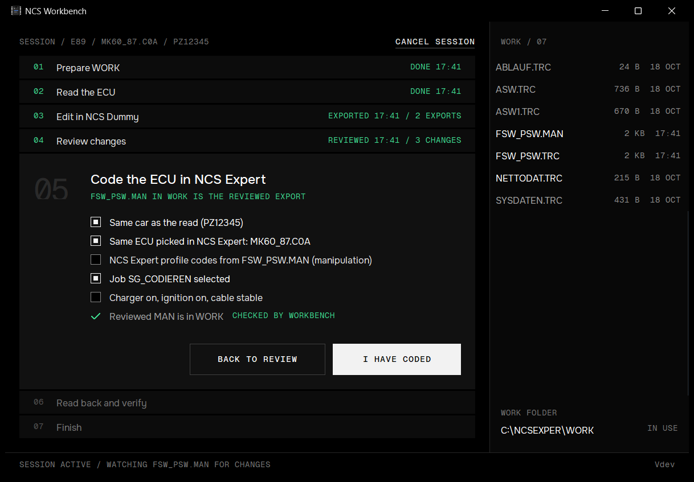

Code the ECU in NCS Expert with `SG_CODIEREN`. The checklist is a reminder; you don't have to tick everything. The last line is checked by Workbench: the MAN in WORK is still the reviewed one.

Workbench can't see whether coding worked. Click **I HAVE CODED** once NCS Expert reports the job finished; it's recorded as your confirmation. If the MAN changed since the review, you're sent back to step 04. **BACK TO REVIEW** goes back yourself.

## 06 Read back and verify

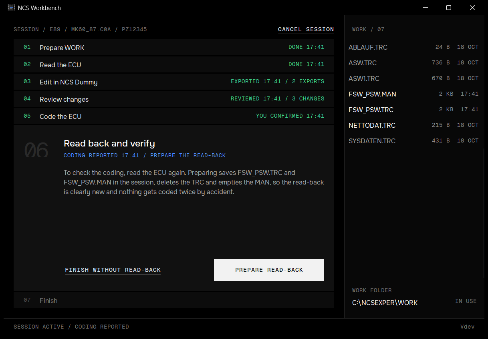

To check the coding, read the ECU again. **PREPARE READ-BACK** clears WORK the same way as step 01:

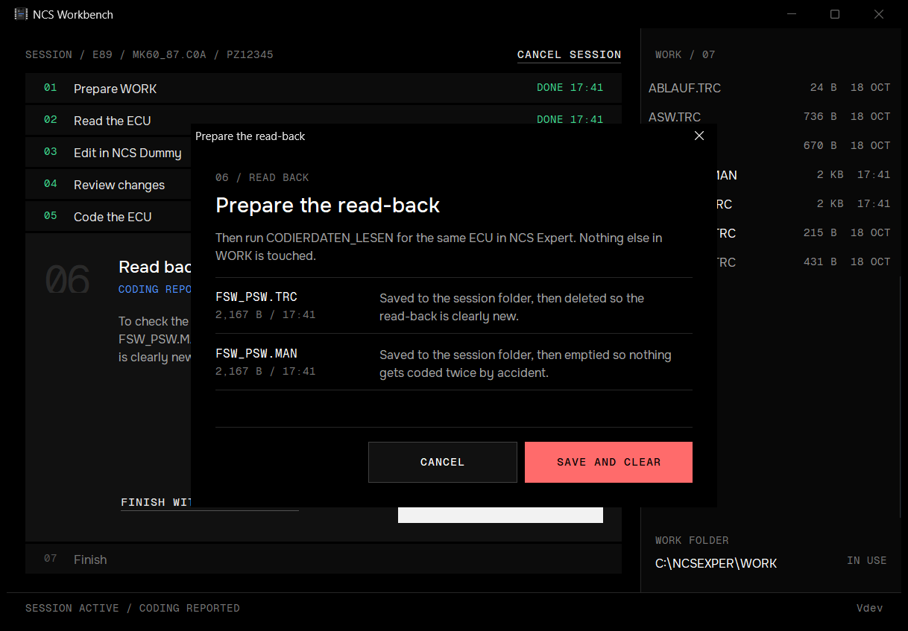

Emptying the MAN also means nothing gets coded twice by accident.

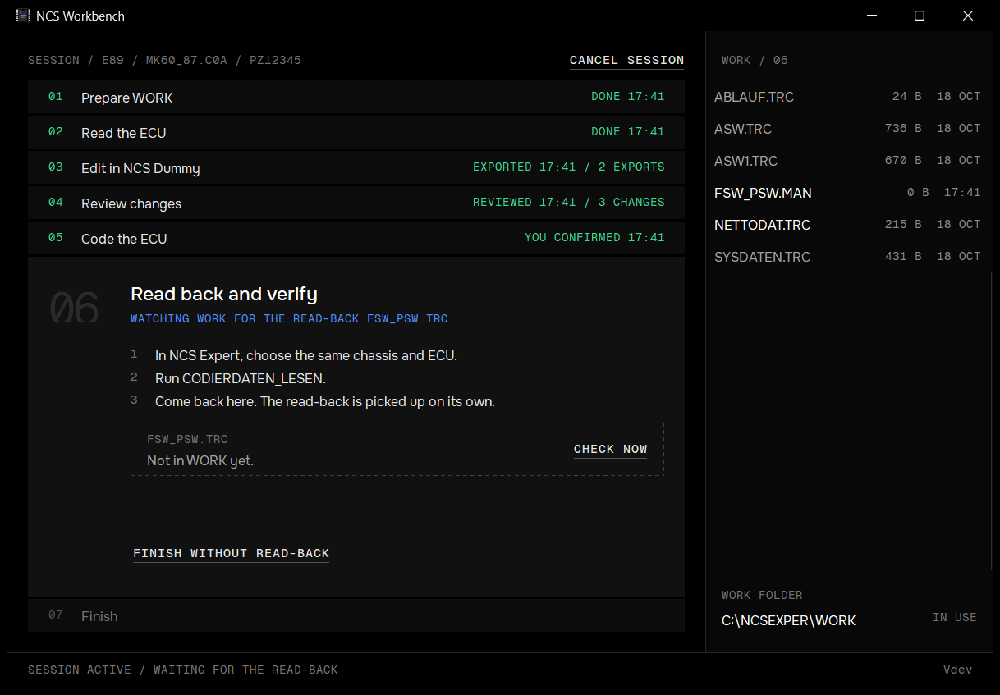

Run `CODIERDATEN_LESEN` for the same ECU. The read-back is taken like the first read; even a trace identical to an earlier one counts, since WORK was cleared.

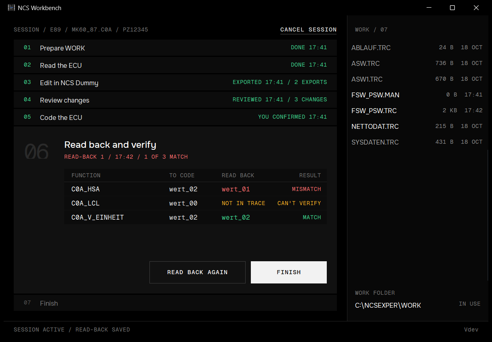

Every intended change gets a result:

| Result | Meaning |
|---|---|
| **MATCH** | The read-back has exactly the value the MAN asked for. |
| **MISMATCH** | The read-back has a different value. |
| **CAN'T VERIFY** | The function isn't in the read-back, has no value, or is listed twice with different values. |

A match means the ECU holds the value. It doesn't prove the feature works in the car.

**READ BACK AGAIN** clears WORK and waits for another read-back. **FINISH WITHOUT READ-BACK** (shown before preparing and while waiting) finishes without verifying.

## 07 Finish

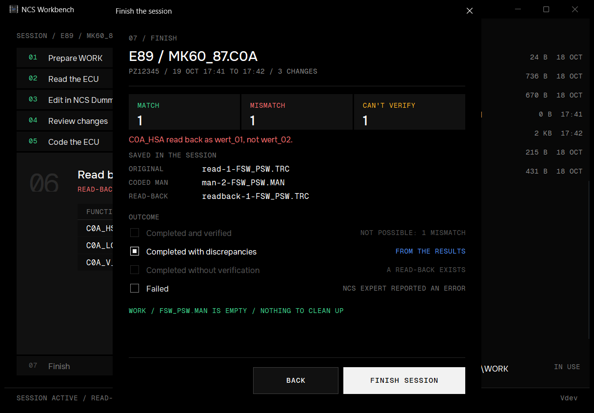

A summary of the session, the files it saved, and the outcome. The outcome is picked from the results, and you can't pick one that contradicts them:

| Outcome | Allowed when |
|---|---|
| **Completed and verified** | There's a read-back with every change a match. |
| **Completed with discrepancies** | There's a read-back. |
| **Completed without verification** | There's no read-back. |
| **Failed** | Always, for example when NCS Expert reported an error. |

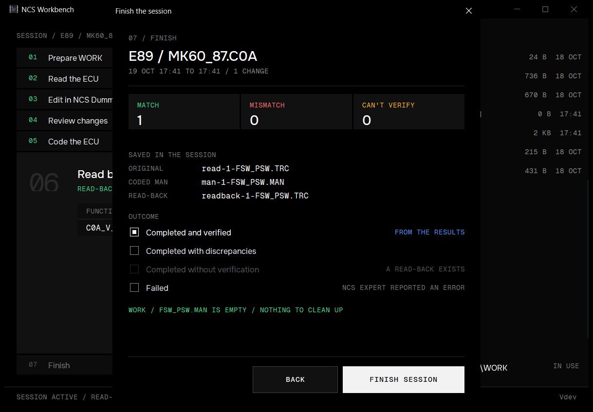

If `FSW_PSW.MAN` in WORK still has something in it, **Empty FSW_PSW.MAN in WORK (saved first)** is offered and ticked. Otherwise the dialog says there's nothing to clean up. **FINISH SESSION** closes the session; **BACK** returns to it.

## Cancel a session

**CANCEL SESSION** at the top right works at any stage. After a confirmation (with **KEEP GOING** focused), the session closes as **CANCELLED**. Every file it saved stays, and WORK isn't changed: the TRC and MAN keep what they have.

## History

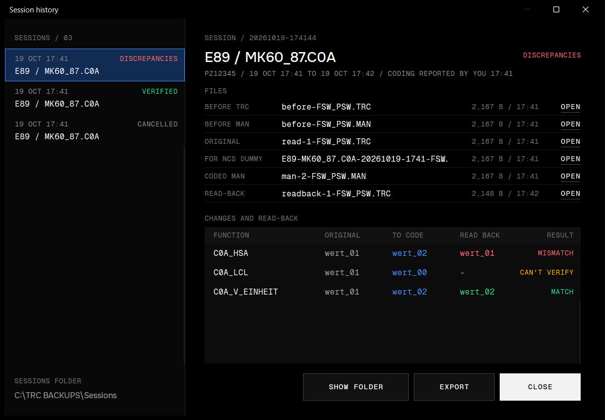

**HISTORY** lists every session, newest first. For the selected one:

- **Files:** the TRC and MAN as they were before the session, the original read, the copy for NCS Dummy, the coded MAN (or the last export) and the read-back. **OPEN** shows a file in Notepad.
- **Changes and read-back:** each intended change with its original, intended and read-back value and result. Sessions without a read-back show **NOT READ BACK**.
- **SHOW FOLDER** opens the session folder. **EXPORT** copies the whole folder somewhere else, for example to send it to someone or keep it with the car's records.

## If Workbench closes mid-session

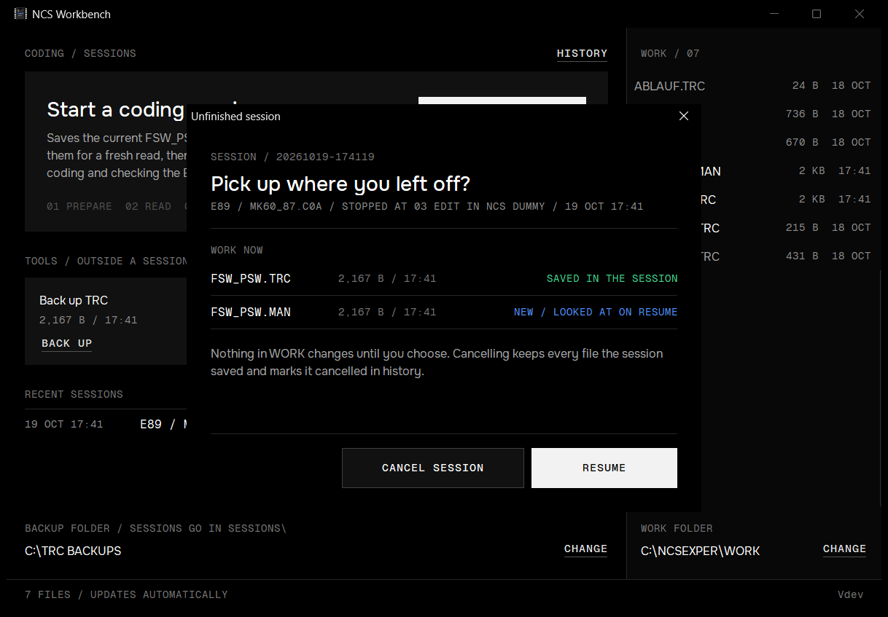

After a crash, a closed window or a power cut, Workbench offers to pick up where you left off the next time it starts. It shows what's in WORK now: files already saved in the session, and new ones (here an exported MAN) that will be looked at when you resume. Nothing changes until you choose. **RESUME** continues; **CANCEL SESSION** closes it as cancelled.

If the session's folder isn't available (a disconnected USB drive, say), Workbench starts normally and asks again next time.

## What's saved

```
C:\TRC BACKUPS\Sessions\20261019-174144\
  session.ini                                 the record: times, ECU, state, every file and its SHA-256
  before-FSW_PSW.TRC, before-FSW_PSW.MAN      WORK as it was when the session started
  read-1-FSW_PSW.TRC                          the ECU read (read-2, ... after READ AGAIN)
  E89-MK60_87.C0A-20261019-1741-FSW_PSW.TRC   the copy for NCS Dummy
  man-1-FSW_PSW.MAN, man-2-FSW_PSW.MAN        every MAN export
  work-1-FSW_PSW.TRC / .MAN                   WORK files saved before a read-back or at the finish
  readback-1-FSW_PSW.TRC                      each read-back
```

The copies are read-only. `session.ini` is plain text and opens in Notepad.
