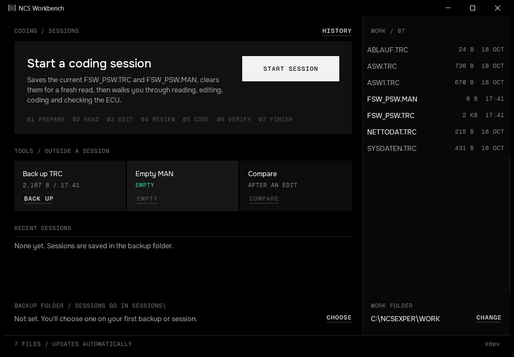
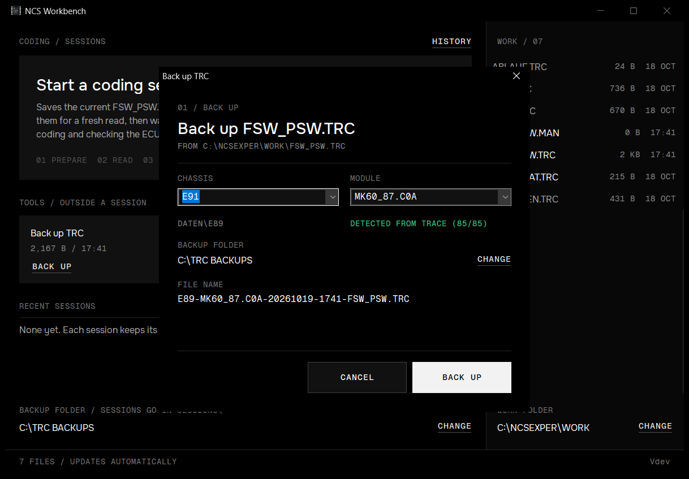
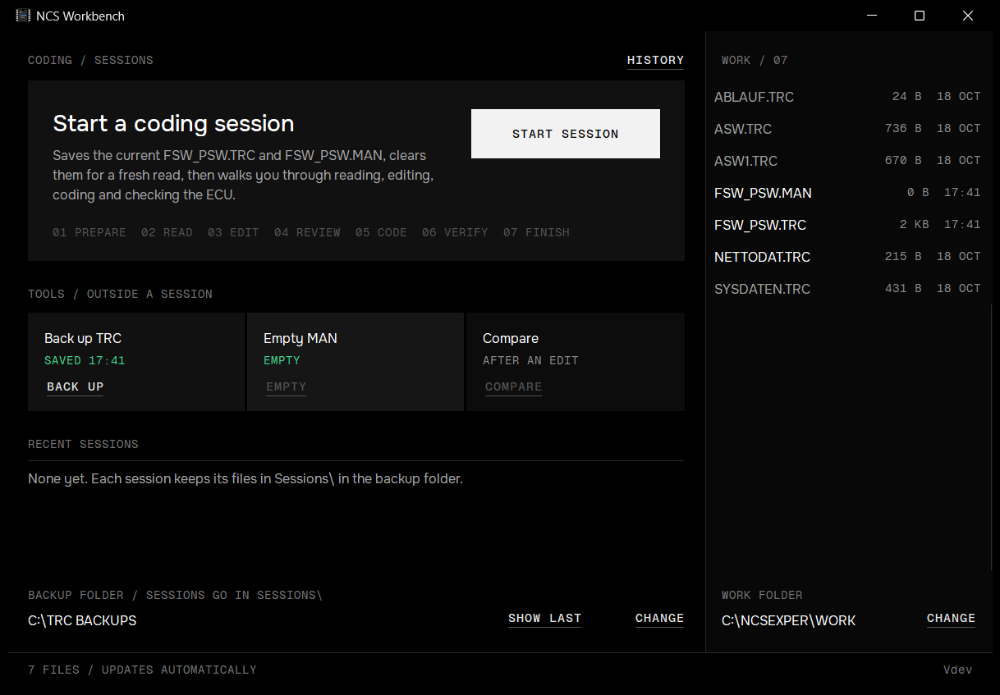
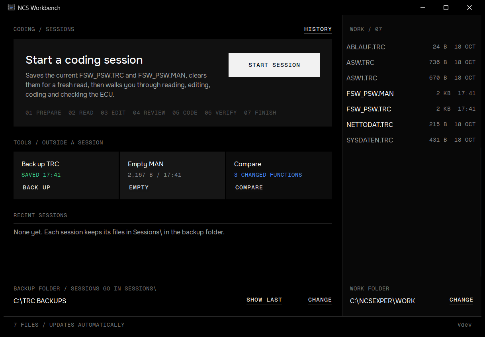
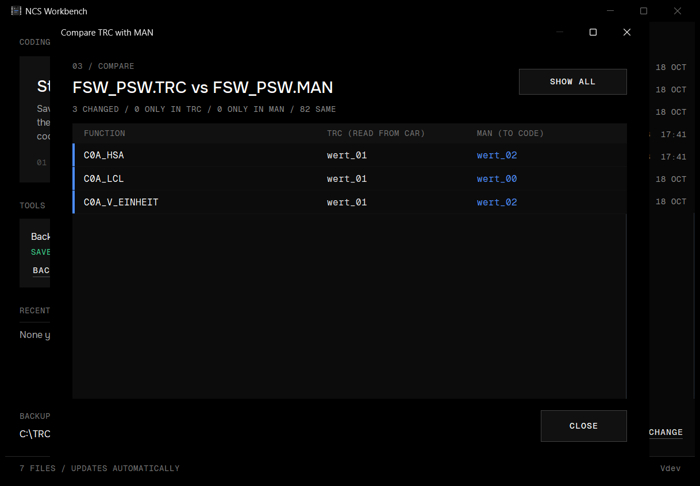
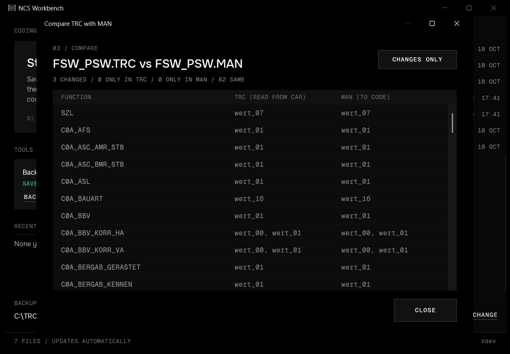
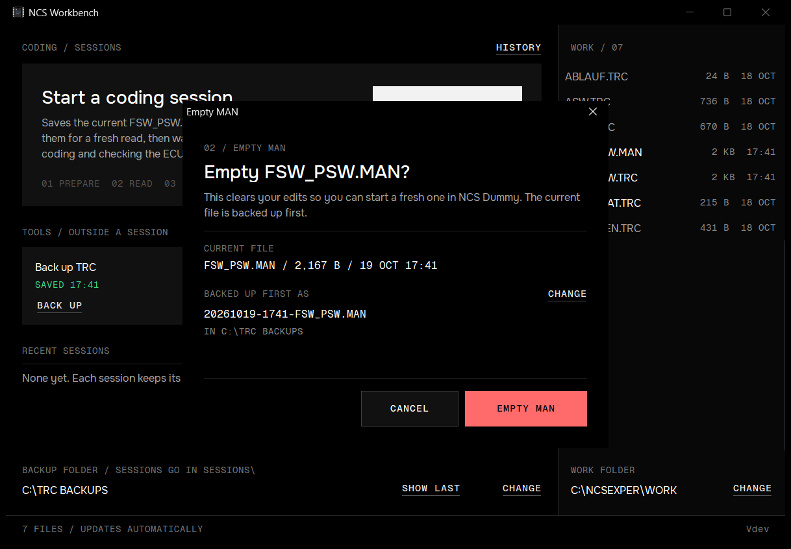
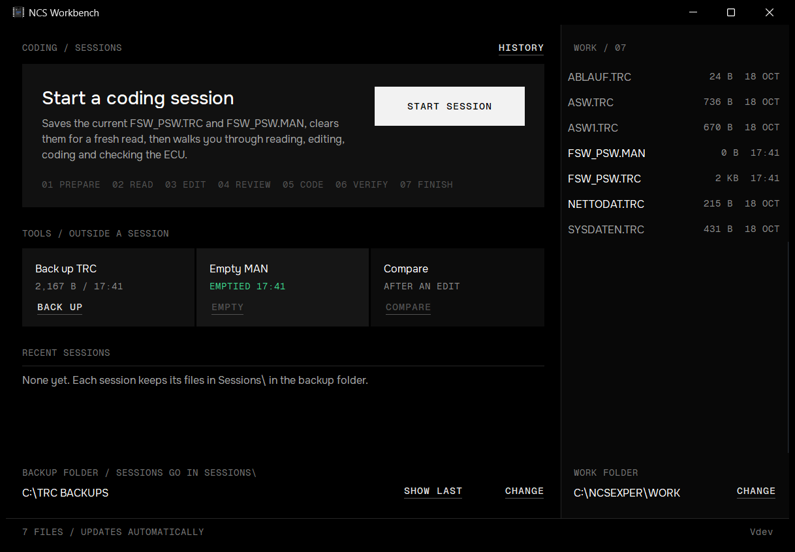

# Main window and tools

A tour of NCS Workbench's main window and the three manual tools: back up the TRC, empty the MAN, compare. For the guided workflow, see [Guided coding sessions](guided-sessions.md).

The screenshots were taken on a test setup: the sample trace from `samples/`, a made-up SP-Daten folder and `C:\TRC BACKUPS` as the backup folder.

## 1. First launch

The window has two columns:

- **Left, the coding column.** The **START SESSION** tile starts a [guided session](guided-sessions.md). Below it, **TOOLS / OUTSIDE A SESSION** holds the three manual tools, each with a status line and a button. **RECENT SESSIONS** lists your last three sessions. **HISTORY** at the top right opens all of them.
- **Right, the WORK folder.** Every file in `C:\NCSEXPER\WORK` with its size and time. The files Workbench works with (`FSW_PSW.TRC`, `FSW_PSW.MAN`, `NETTODAT.TRC`) are shown brighter. The list updates on its own when NCS Expert or NCS Dummy writes a file. **CHANGE** under the list picks another WORK folder.

The footer shows the file count and whether the list updates automatically. On the right, **THEME** switches the [colour scheme](themes.md) and the build's version follows it.

There's no backup folder yet, so the block at the bottom left says **Not set** and offers **CHOOSE**. You're also asked for a folder the first time a backup or session needs one.

Tool buttons are greyed out when they have nothing to work on. Here the MAN is empty, so **EMPTY** and **COMPARE** are off.

## 2. Back up the TRC

**BACK UP** opens this dialog. Pick the chassis you chose in NCS Expert. With SP-Daten installed (`C:\NCSEXPER\DATEN`), the list comes from it and the line under the field shows the data folder the chassis uses: an E91 uses `DATEN\E89`. The module is detected from the trace's function names (here 85 of 85 matched).

The file name is `CHASSIS-MODULE-YYYYMMDD-HHMM-FSW_PSW.TRC`, the pattern NCS Dummy reads the chassis and module from. **CHANGE** picks another backup folder.

Other cases:

- **No SP-Daten:** the chassis line says **SP-DATEN NOT FOUND** and both fields are typed, with built-in lists of common chassis and modules.
- **No clear module:** if no module has at least 80% of the trace's functions and more than twice the runner-up, the line says **NO CLEAR MATCH, PICK ONE**.
- **Same minute, same name:** a second backup gets `-2`, `-3`, ... before `-FSW_PSW.TRC`. Backups are never overwritten.

## 3. Backup saved

The tile confirms the backup in green. **SHOW LAST** opens Explorer with the new file selected.

## 4. A MAN to compare

Once NCS Dummy has written a MAN, the Compare tile counts the changes live, and **EMPTY** and **COMPARE** become available.

## 5. Compare the TRC with the MAN

**COMPARE** lists what the MAN will change, function by function: **Function**, the value read from the car, the value to code. A blue bar and a blue value mean changed. A function found in only one file is marked amber.

**SHOW ALL** includes the unchanged functions; **CHANGES ONLY** goes back. The window can be resized.

NCS Expert accepts a MAN that lists only the functions to change. When the MAN has under half the trace's functions, it counts as **partial**: functions missing from it aren't flagged, because they won't be touched.

## 6. Empty the MAN

**EMPTY** clears `FSW_PSW.MAN` so you can start a fresh edit in NCS Dummy. The current file is backed up first, as `YYYYMMDD-HHMM-FSW_PSW.MAN`. It's only emptied if that copy succeeded. **CANCEL** has the focus, so a stray Enter doesn't empty anything.

## Other states

- **WORK folder missing:** the panel head says **WORK / NOT FOUND** in amber and the footer **WORK FOLDER NOT FOUND / CHECKING EVERY 3 S**. The list comes back by itself once the folder exists, for example when a USB stick or VM shared folder is connected.
- **Folders that never signal changes** (some network and VM shares): the footer says **CHECKING EVERY 3 S** and the list is refreshed by polling.
- **Narrow window:** below about 470 px of coding column, the step numbers hide, buttons shrink and the START SESSION button moves under its text.
- **During a session:** the tools and the WORK folder's **CHANGE** are hidden, and the panel says **IN USE**, so nothing else touches the TRC or MAN while a session runs.
- **Title bar and scrollbars** are dark on Windows 10 1809 and later. On older Windows they follow the system style.
