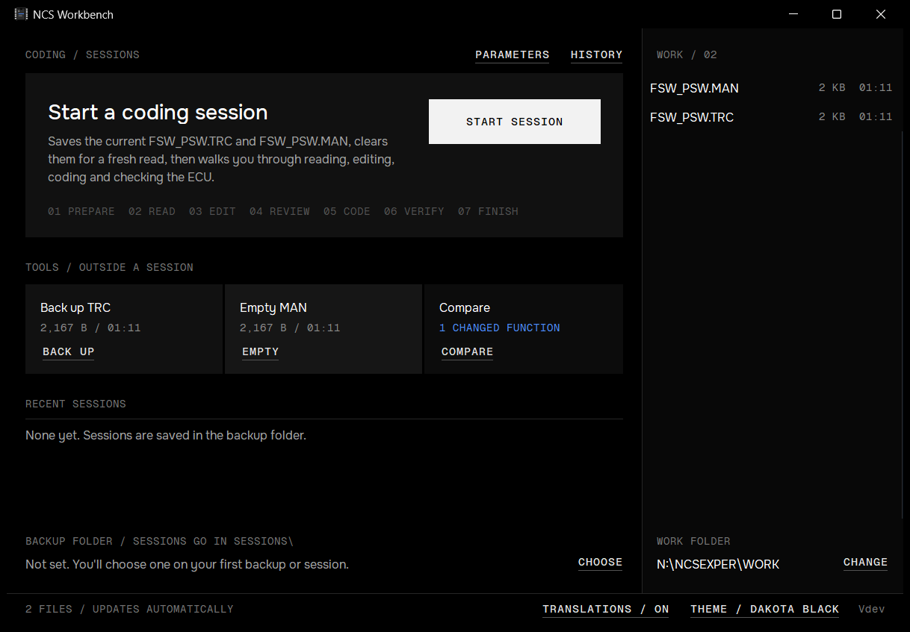
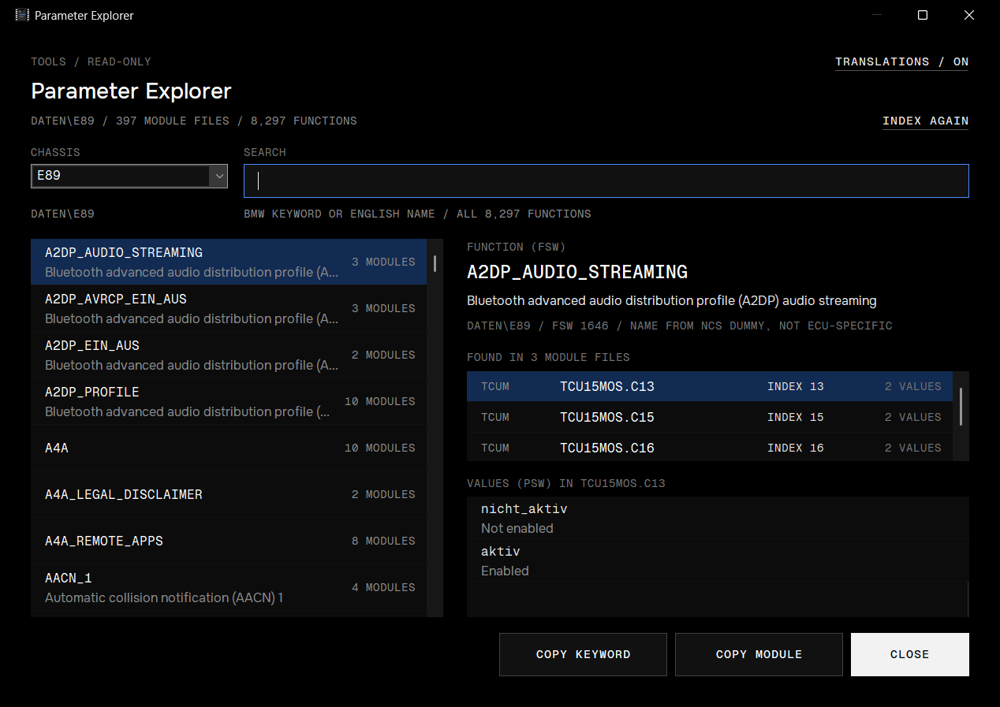
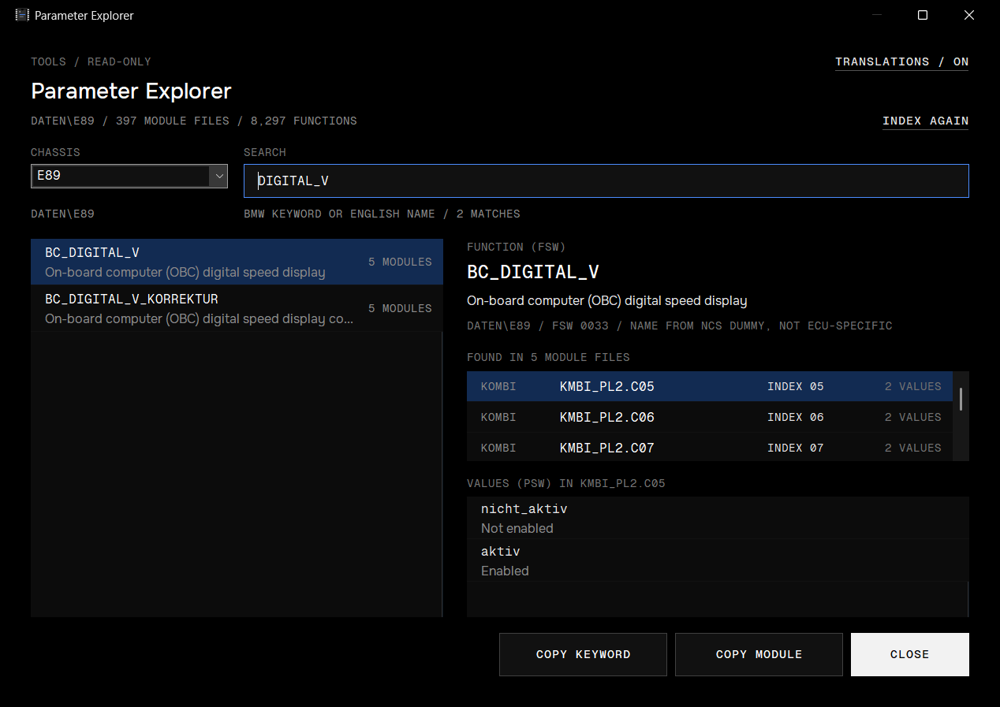
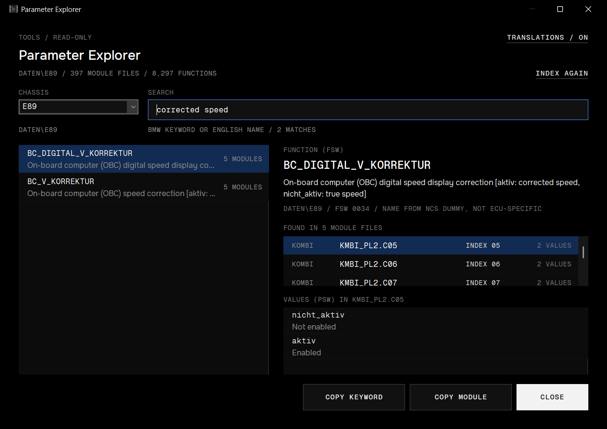
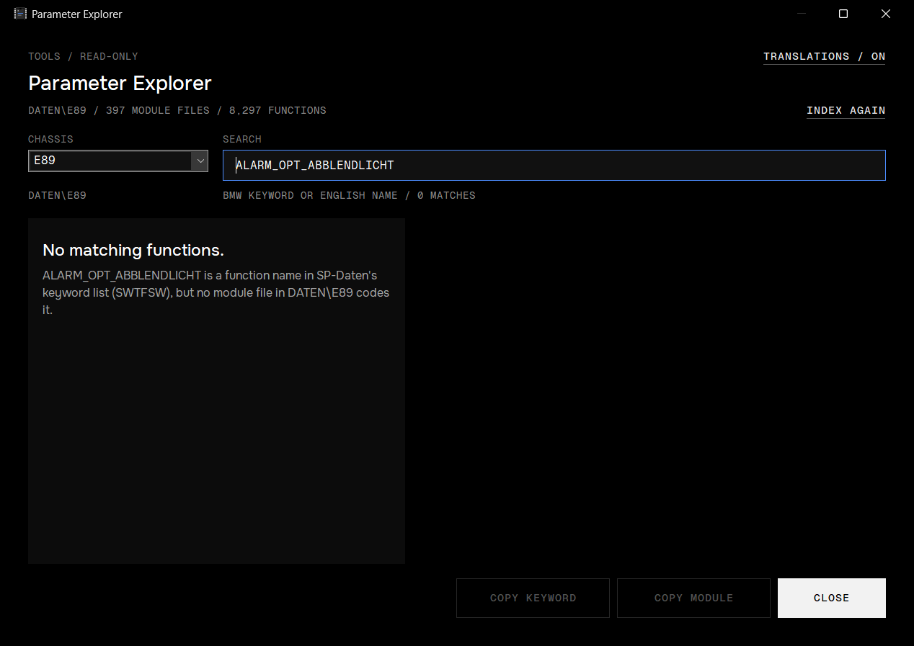
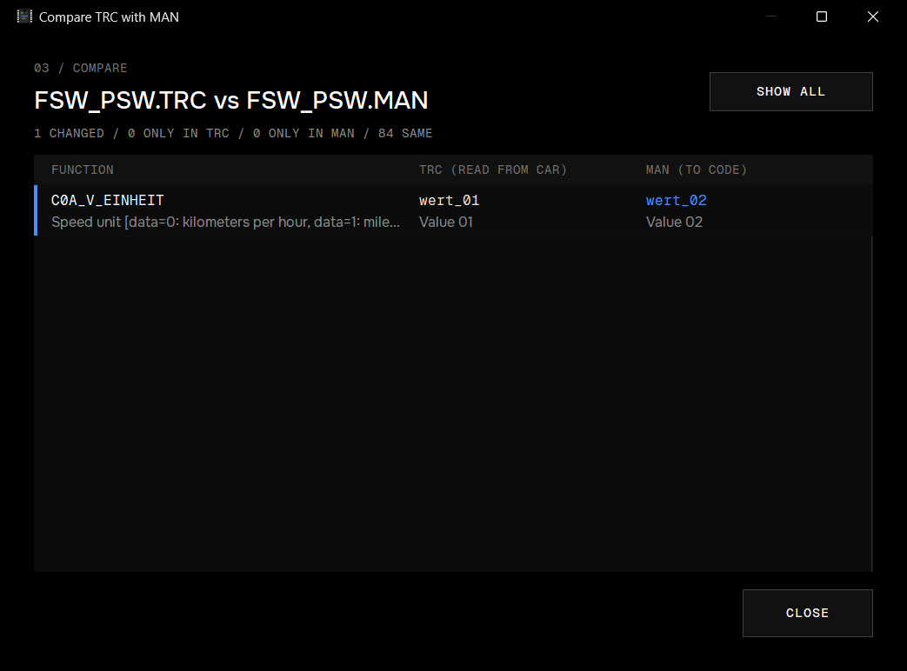
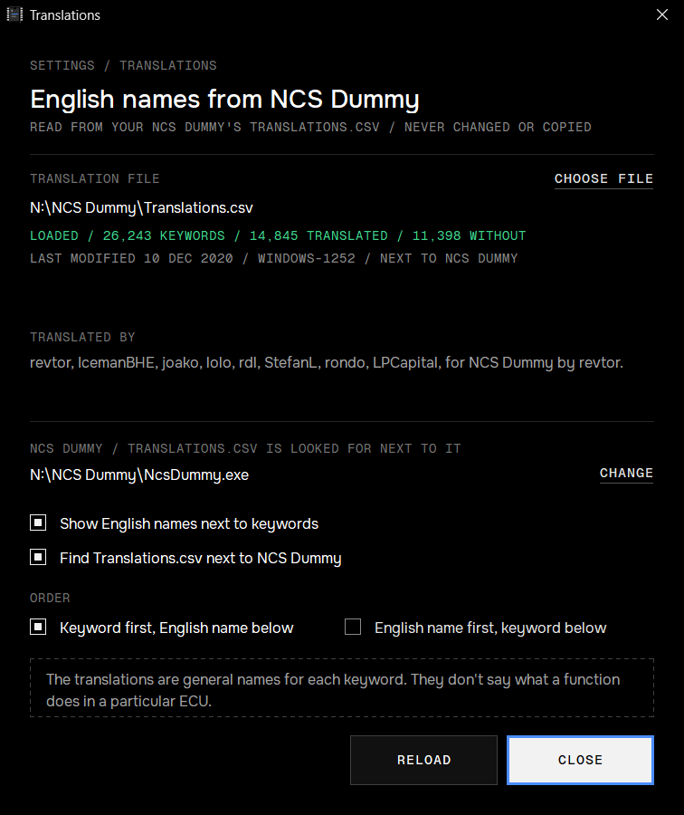

# Parameter Explorer and English names

Two read-only helpers for working out what a coding function is and where it lives:

- **Parameter Explorer** searches every module file of an SP-Daten chassis and lists the modules that code a function, with their coding index and values.
- **English names** come from your own NCS Dummy's `Translations.csv` and show next to the BMW keywords across Workbench.

Neither one codes, edits or changes anything: not the car, not SP-Daten, not the translation file. NCS Dummy stays the place where you edit coding.

The screenshots were taken on a test setup: a real E89 SP-Daten folder, NCS Dummy's own `Translations.csv` (last modified 10 Dec 2020) and the sample trace from `samples/`. Neither SP-Daten nor the translations come with Workbench.

## 1. Where to find them

- **PARAMETERS**, at the top right next to **HISTORY**, opens the Parameter Explorer. Like the tools, it's there outside a session only: a session doesn't watch WORK while another window is open, and the explorer is one you'd keep open.
- **TRANSLATIONS / ON** in the footer, left of the theme, opens the [translation settings](#8-translation-settings). It says **OFF** when the English names are hidden and **NONE** when no translation file is loaded.

## 2. What the explorer needs

- **SP-Daten** in the `DATEN` folder next to your WORK folder: with `C:\NCSEXPER\WORK`, that's `C:\NCSEXPER\DATEN`. It's the same SP-Daten the Back up TRC dialog uses, and there's no separate setting. To look at another SP-Daten copy, point the WORK folder at a folder that has a `DATEN` folder beside it (see [Trying it on a copy](#trying-it-on-a-copy)).
- **English names** (optional): NCS Dummy's `Translations.csv`. Without it the explorer works the same, with BMW keywords only.

If there's no `DATEN` folder, the explorer says **SP-DATEN NOT FOUND** and shows where it looked.

## 3. Open the explorer

1. Pick a **CHASSIS**. The list only offers chassis whose data is actually installed: the chassis in SP-Daten's `BR_REF.DAT` whose folder exists and has module files (`*.Cxx`), plus any installed folder `BR_REF.DAT` doesn't name, under its own name. A folder with no module files isn't offered. The line below the field shows the data folder it uses: an E91 uses `DATEN\E89`, like every E8x/E9x. Chassis that share a folder share one index, so switching between them is instant.
2. Workbench reads every module file (`*.Cxx`) in that folder once. The status line counts them while it does (**INDEXING DATEN\E89 / 120 OF 397 MODULE FILES**); a full E89 folder takes well under a second. **STOP** ends it early, and **INDEX AGAIN** reads the folder again.
3. With the search field empty, every function is listed alphabetically.

The window remembers the chassis you picked. With no saved choice, it starts with the chassis from your last backup, or else the chassis named like its folder (E89).

If SP-Daten changes while the window is open (you copy in a newer version, say), the folder is read again when you come back to the window.

## 4. Search

Type part of a function name. Case doesn't matter. Results are ranked:

1. the exact name (`BC_DIGITAL_V`),
2. names that start with what you typed,
3. names that contain it (`DIGITAL_V` finds `BC_DIGITAL_V`),
4. with English names loaded, functions whose name or English name contains every word you typed.

Each function is listed once, with how many module files code it, however many coding indexes it appears in.

Searching in English finds functions whose German keyword has nothing in common with the words. `corrected speed` finds `BC_DIGITAL_V_KORREKTUR` through its note *[aktiv: corrected speed, nicht_aktiv: true speed]*. The whole English text is searched, notes in brackets included. Words can mix both: `bc correction` finds it too.

Values such as `aktiv` or `wert_01` aren't functions, so searching for them finds nothing on its own.

## 5. Read a result

The right side shows the selected function:

- **The keyword**, with **COPY KEYWORD** to put it on the clipboard (to find it in NCS Dummy, say).
- **The English name**, in full, with a note that it's NCS Dummy's general name for the keyword, not a description of what the function does in this ECU. If there is none, it says so.
- **DATEN\E89 / FSW 0033**: the data folder and the function's id in SP-Daten.
- **FOUND IN 5 MODULE FILES**: every module file in the folder that codes the function. Each row shows the ECU family (**KOMBI**, from SP-Daten's ECU table), the file (`KMBI_PL2.C05`), its **coding index** (05) and how many values it offers. Coding indexes are kept apart: the same function in `.C05` and `.C07` is two rows. **COPY MODULE** copies the selected file name.
- **VALUES (PSW) IN KMBI_PL2.C05**: the values that module offers for the function, with their English names. Click another module row to see its values; they can differ between coding indexes.

![FAHRGESTELL_NR[10]: coded with a number in the eCall module, so there's no list of values](../screenshots/parameters/05-direct-number.png)

Some functions are coded with a number instead of picked from a list (here a VIN character). Their module rows say **NUMBER**, and the values area says the module codes the function with a number.

A module in the list means SP-Daten has coding data for it, not that your car has that ECU or that it's at that coding index.

## 6. When nothing is found

**No matching functions** means no module file that was read has a function named, or with an English name, like your search. Two cases get a note:

- **The name is in SP-Daten's keyword list, but no module codes it.** SP-Daten's keyword list (`SWTFSW*.DAT`) names every function BMW uses in that folder, including ones no module in it codes. The explorer only lists functions it found in a module file. Neither the keyword list nor NCS Dummy's translations count as a module having a function.
- **Some module files couldn't be read.** The status line turns amber (**3 OF 397 MODULE FILES COULDN'T BE SEARCHED / RESULTS MAY BE INCOMPLETE**) and **WHICH FILES** lists them with the reason (unreadable, damaged, unknown format). The function may be in one of them, so the explorer won't say it isn't there. The same goes for an index stopped with **STOP**.

Other problems the status line shows:

- **NO SWTFSW\*.DAT**: the folder has no keyword list, so function ids can't be named or searched.
- **NO SWTPSW\*.DAT: VALUES UNNAMED**: values show as ids (**PSW 0019**) instead of names.
- **NO MODULE FILES (\*.CXX)**: the folder has none to read.
- **THIS CHASSIS ISN'T IN SP-DATEN**: the chassis you typed isn't in the list.
- **NO CHASSIS FOLDER WITH MODULE FILES (\*.CXX)**: `DATEN` exists, but none of its folders has coding data.

## 7. English names in the other windows

With a translation file loaded, the English names show under the keywords in:

- **Compare** (the tool and the session's **COMPARE**),
- the session's **review** and **read-back** tables,
- **HISTORY**'s changes and read-back table,
- the Parameter Explorer.

Values get their English name when a function has a single value (`wert_02` / *Value 02*). Functions with several values (`wert_00, wert_01`) show the values only.

The keywords never change: the TRC, the MAN, the comparison, the session record and the read-back check all use the BMW names. The English names are only drawn on screen.

## 8. Translation settings

**TRANSLATIONS** in the footer (or at the top right of the explorer) opens this window.

- **TRANSLATION FILE**: the file in use. By default Workbench looks for `Translations.csv` next to `NcsDummy.exe`, the same NCS Dummy that **OPEN NCS DUMMY** starts. **CHOOSE** (or **CHANGE**) under **NCS DUMMY** picks it. **CHOOSE FILE** uses another file instead, without needing NCS Dummy at all. **USE NCS DUMMY'S** goes back to the one next to NCS Dummy.
- **Status**: how many keywords the file lists, how many have an English name and how many don't (over 40% of the keywords in NCS Dummy's file have none). Below it, when the file was last changed and its encoding.
- **Problems**: rows that couldn't be read, keywords listed twice with different text (the first is used) or characters that couldn't be decoded. The rest of the file still loads.
- **TRANSLATED BY**: the file's contributors. The English names are by revtor and contributors, part of NCS Dummy.
- **Show English names next to keywords**: off hides them everywhere and the footer says **TRANSLATIONS / OFF**. Searching by English name also stops.
- **Find Translations.csv next to NCS Dummy**: off means only a file you chose is used.
- **ORDER**: keyword first with the English name below (default), or the English name first.
- **RELOAD** reads the file again, for example after you've updated NCS Dummy.

If a file you chose can't be read, Workbench says so rather than quietly using NCS Dummy's. Without any translation file, everything works as before, with BMW keywords only.

The settings are stored with Workbench's other settings (`HKEY_CURRENT_USER\Software\NCS Workbench`: `TranslationsPath`, `TranslationsAuto`, `TranslationsShow`, `TranslationsOrder`, and `ExplorerChassis` for the explorer).

## Trying it on a copy

The explorer only reads files, so it runs fine on a PC that never connects to a car, with a copy of SP-Daten:

1. Make a folder with an empty `WORK` folder and a `DATEN` folder next to it, for example `C:\NCS Test\WORK` and `C:\NCS Test\DATEN`.
2. Copy or extract a chassis folder of SP-Daten into `DATEN` (for example `DATEN\E89`).
3. In Workbench, click **CHANGE** under the WORK folder and pick `C:\NCS Test\WORK`.
4. Under **TRANSLATIONS**, pick your `NcsDummy.exe` (or the `Translations.csv` itself with **CHOOSE FILE**).
5. Click **PARAMETERS**.

Copy an `FSW_PSW.TRC` and `FSW_PSW.MAN` into the test `WORK` folder to see the English names in Compare. Switch the WORK folder back with **CHANGE** when you're done. The settings stay on that PC.
