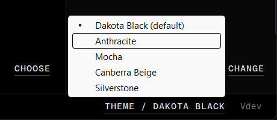
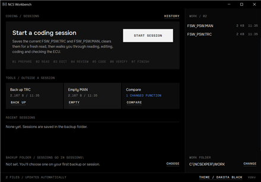
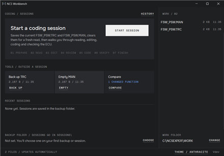
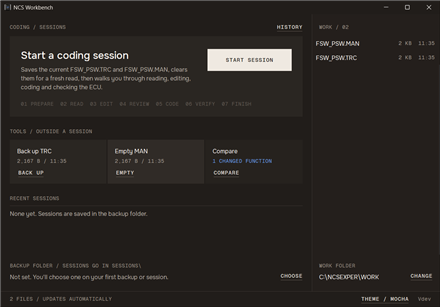
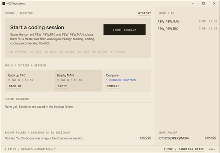
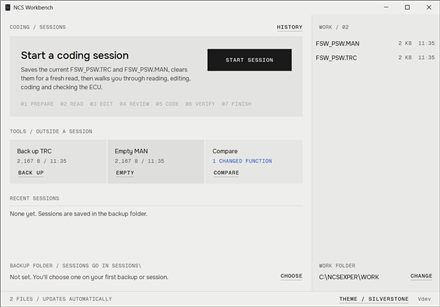

# Themes

NCS Workbench has five colour schemes, named after BMW interior colours. Dakota Black is the default. The others are easier on the eyes: two dim schemes that aren't fully black, and two light ones for bright rooms or a laptop in the garage.

## Change the theme

1. Click **THEME / DAKOTA BLACK** (or your current theme's name) at the bottom right of the main window, next to the version.
2. Pick a theme from the menu. The tick marks the current one.

The window changes straight away, and every dialog opened after that uses the new theme. Workbench remembers your choice in the registry (`HKEY_CURRENT_USER\Software\NCS Workbench`, value `Theme`). Like the other settings, the theme stays on that PC: running the exe from a USB stick on another PC starts with Dakota Black.

## The themes

<table>
  <tr>
    <td width="50%">
       
      <b>Dakota Black</b> (default) 
      The original look: black with grey tiles.
    </td>
    <td width="50%">
       
      <b>Anthracite</b> (dim) 
      Neutral charcoal, after BMW Individual's anthracite headliner.
    </td>
  </tr>
  <tr>
    <td>
       
      <b>Mocha</b> (dim) 
      Warm brown-black, after Dakota and Vernasca Mocha leather.
    </td>
    <td>
       
      <b>Canberra Beige</b> (light) 
      Cream and sand, after Vernasca Canberra Beige leather.
    </td>
  </tr>
  <tr>
    <td>
       
      <b>Silverstone</b> (light) 
      Plain light grey, after M Merino Silverstone leather.
    </td>
    <td></td>
  </tr>
</table>

## Notes

- **Readability:** in Anthracite, Mocha, Canberra Beige and Silverstone, all text has a contrast of at least 4.5:1 against its background (WCAG AA). Dakota Black's faintest grey is a little lower.
- **Colours keep their meaning:** blue is focus and selection, green is done, amber is a warning and red is an error in every theme. The light themes use darker shades so they stay readable on cream and grey.
- **Title bar:** on Windows 10 and 11, the title bar and scrollbars follow the theme: dark for the dark themes, light for the light ones. Windows 11 also colours the title bar to match. On Windows XP and 7 the title bar stays as Windows draws it.
- **System dialogs:** the folder picker and the theme menu itself are drawn by Windows, so they look the same in every theme.
