# VO coding sessions

A VO session guides you through coding an ECU from the vehicle order (VO, the FA) with `SG_CODIEREN`: after changing the VO's option codes, or to bring a replacement or second-hand module in line with the car. NCS Expert reads, Workbench captures, NCS Expert codes from the VO, Workbench reads back and shows what changed. No NCS Dummy and no MAN edit are involved.

Unlike a [MAN session](guided-sessions.md), nothing tells Workbench in advance what the values should be: NCS Expert works them out from the VO and SP-Daten. So the read-back isn't checked against a target. It's compared with the first read, and you see every function the coding changed.

The screenshots were taken on a test setup: a real read of a PGS (Comfort Access) module before and after VO coding, a made-up SP-Daten folder and `C:\TRC BACKUPS` as the backup folder. The module had been coded for an E89; VO coding in an E91 changed three functions. For the rest of the window, see [Main window and tools](main-window.md).

## Before you start

- **Backup folder.** Sessions are saved in its `Sessions` folder. If none is set, you're asked for one when you start your first session.
- **SP-Daten** (`C:\NCSEXPER\DATEN`) is optional. With it, the chassis list comes from SP-Daten and the module is suggested from the trace.
- **FSW_PSW.MAN.** NCS Expert codes a non-empty `FSW_PSW.MAN` on top of the VO. Workbench empties it when the session starts and checks it's still empty before you code.

## 01 Prepare WORK

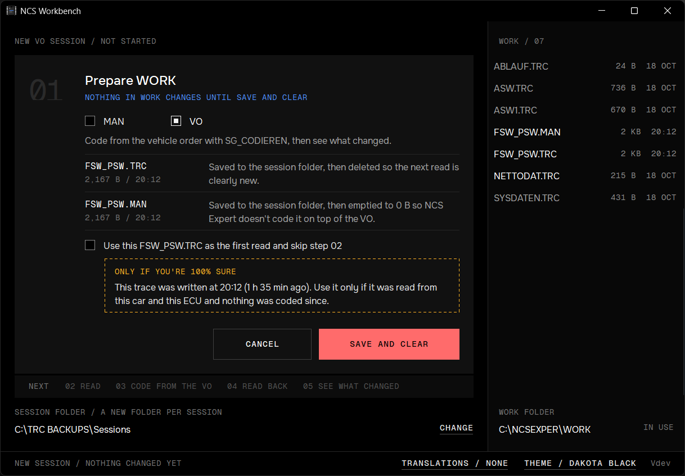

**START SESSION** on the home screen shows step 01 in the window. Nothing has started yet, and nothing in WORK changes until you confirm. Pick **VO**; Workbench offers the type you picked last time, and the **NEXT** strip shows the VO stages to come. The tile lists what will happen to the two files, and updates if they change while you look:

- `FSW_PSW.TRC` is saved to the session folder, then **deleted**, so the next read is clearly a new one.
- `FSW_PSW.MAN` is saved, then **emptied**, so NCS Expert doesn't code it on top of the VO. If there's no MAN, an empty one is created.

Nothing else in WORK is touched. **SAVE AND CLEAR** is red because it changes files, and **CANCEL** (or Esc) has the focus and goes back to the home screen. **CHANGE** next to the session folder picks another backup folder.

**Use this FSW_PSW.TRC as the first read** skips step 02 and keeps the TRC. Only tick it if you're sure the trace was just read from this car and this ECU and nothing was coded since. If preparing stops (a file open in another program, a full backup drive), see [If preparing fails](guided-sessions.md#if-preparing-fails).

## 02 Read the ECU

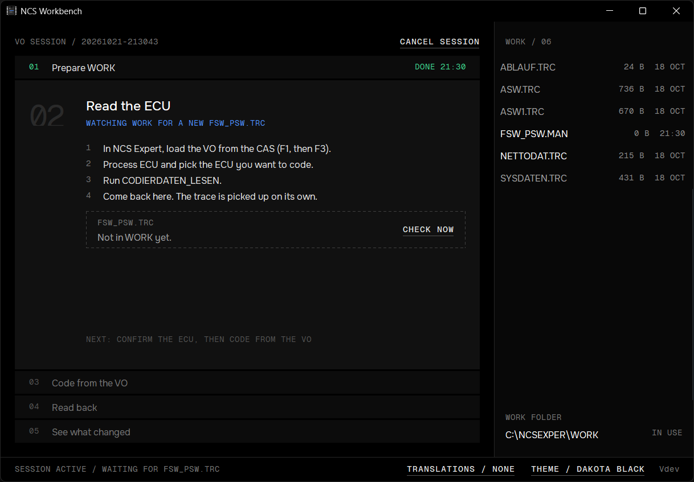

In NCS Expert, load the VO from the CAS (F1, then F3), choose **Process ECU** and pick the ECU. Run `CODIERDATEN_LESEN` and come back. Workbench takes the new `FSW_PSW.TRC` on its own, once NCS Expert has finished writing it. **CHECK NOW** looks right away.

This read is the **before** of the session: every change is measured against it.

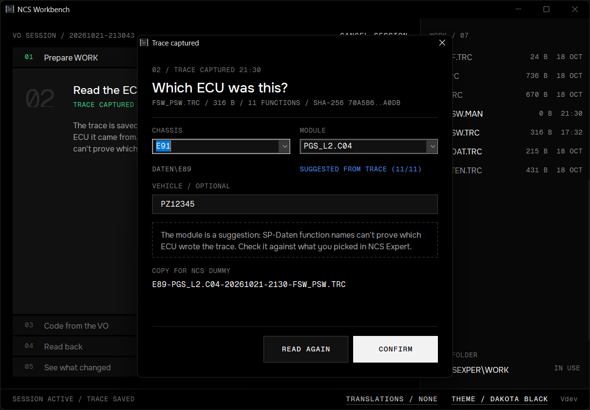

The trace doesn't say which ECU it came from, so you confirm it, as in a [MAN session](guided-sessions.md#which-ecu-was-this). With SP-Daten, the module is suggested from the trace's function names. **CONFIRM** also saves a copy named `CHASSIS-MODULE-YYYYMMDD-HHMM-FSW_PSW.TRC`, which NCS Dummy can open if you want to look at the read there. **READ AGAIN** discards the read and waits for a new one.

## 03 Code from the VO

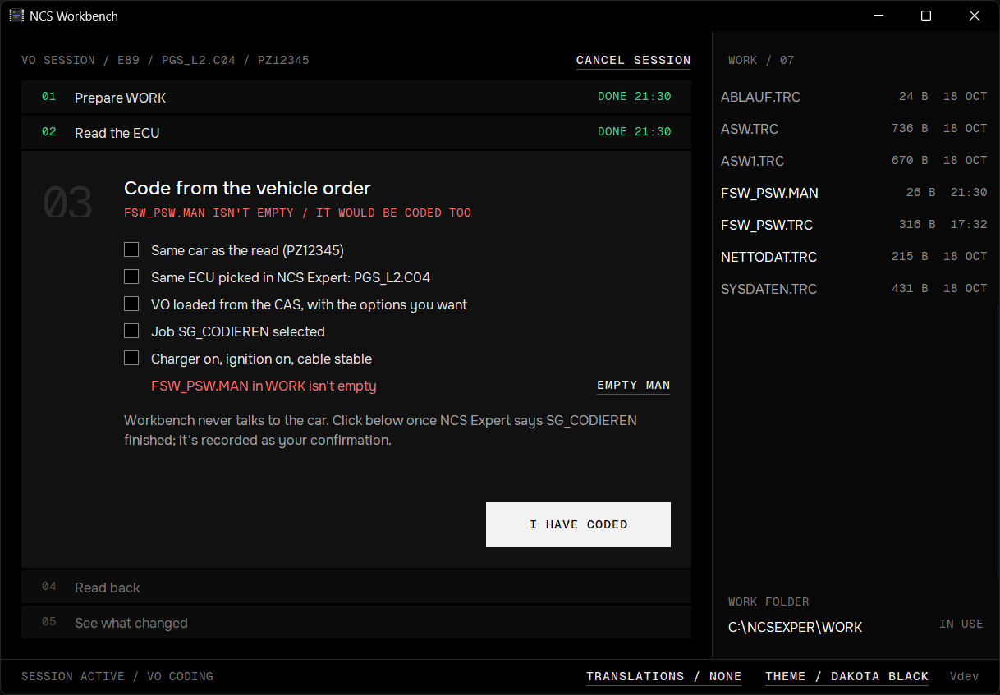

The last line of the checklist is checked by Workbench: **FSW_PSW.MAN in WORK must be empty or missing.** Here a MAN turned up after the read (exported from NCS Dummy, say), so the status line is red. Coding now would apply that MAN on top of the VO.

**EMPTY MAN** saves the MAN to the session folder first, then empties it:

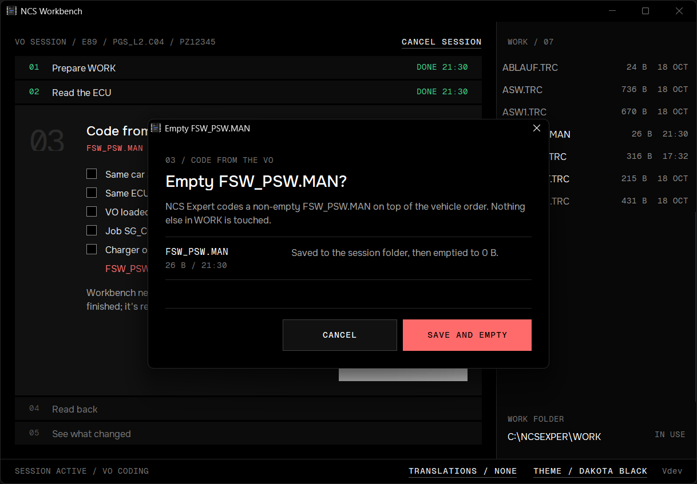

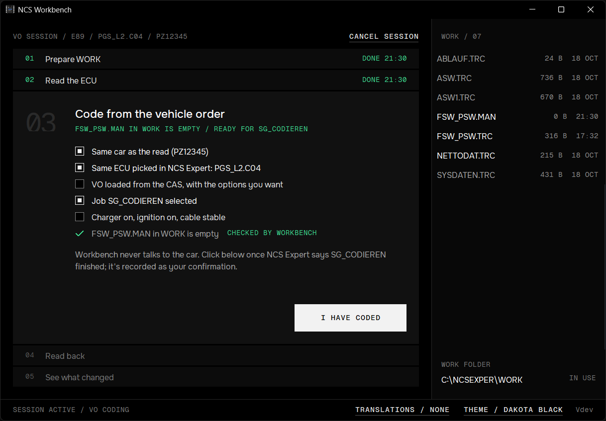

Now run `SG_CODIEREN` for the ECU in NCS Expert. The rest of the checklist is a reminder; you don't have to tick everything.

Workbench can't see whether coding worked. Click **I HAVE CODED** once NCS Expert reports the job finished; it's recorded as your confirmation. While the MAN isn't empty, **I HAVE CODED** is refused. If you already coded with a MAN in WORK, empty it and run `SG_CODIEREN` again.

## 04 Read back

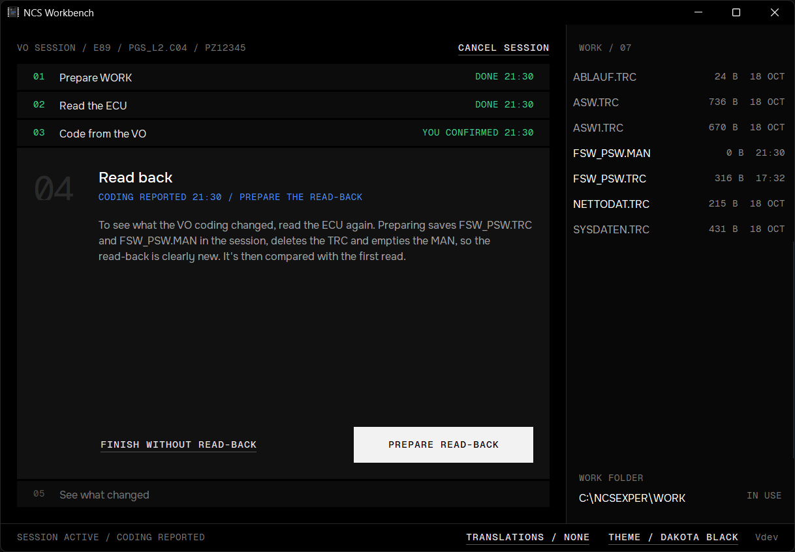

To see what the coding changed, read the ECU again. **PREPARE READ-BACK** clears WORK the same way as step 01:

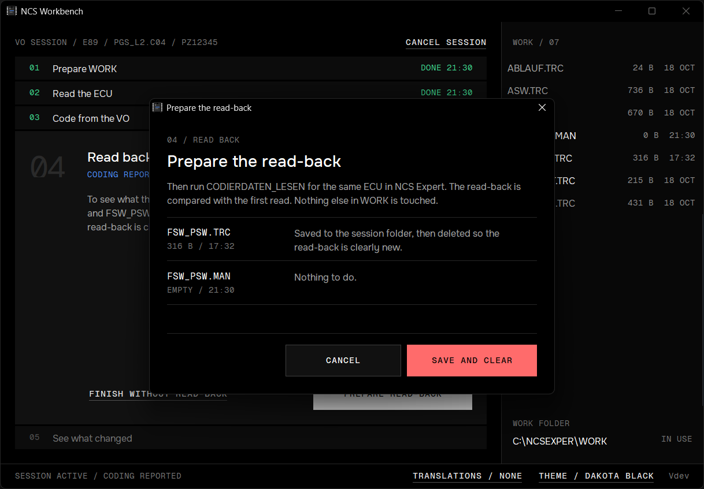

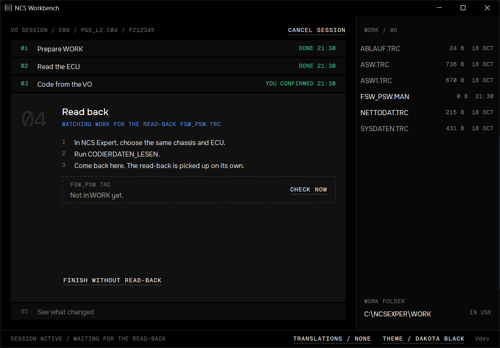

Run `CODIERDATEN_LESEN` for the same ECU. The read-back is taken like the first read; even a trace identical to the first one counts, since WORK was cleared. **FINISH WITHOUT READ-BACK** finishes without one, but then nothing shows what the coding did.

## 05 See what changed

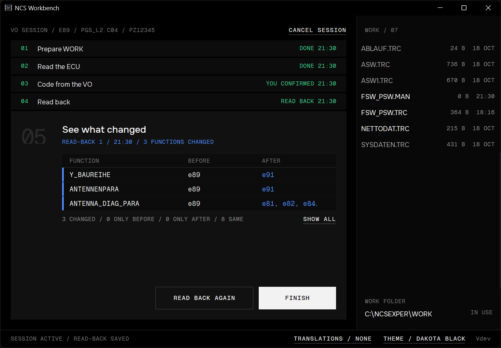

Every function the read-back differs in from the first read:

| Row | Meaning |
|---|---|
| Blue bar, blue value | The value changed. |
| Amber bar, **NOT AFTER** | The function was in the first read but isn't in the read-back. |
| Amber bar, **NOT BEFORE** | The function is new in the read-back. |

Here the module had been coded for an E89 (`Y_BAUREIHE e89`). Coding from the E91's VO set the series and antenna parameters for the E91 and left the other eight functions as they were.

The values come from the VO and SP-Daten, so Workbench can't tell whether they're what you wanted. Check them against what you meant to change. **SHOW ALL** opens the two reads side by side; its own **SHOW ALL** lists every function, not only the changes:

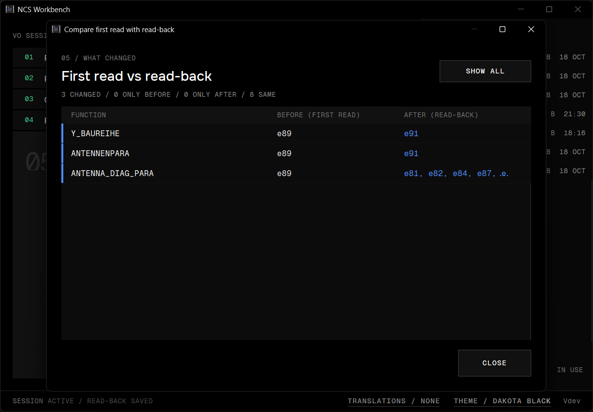

If the read-back has under half of the first read's functions, an amber warning asks whether it came from the same ECU. **READ BACK AGAIN** clears WORK and waits for another read-back.

## Finish

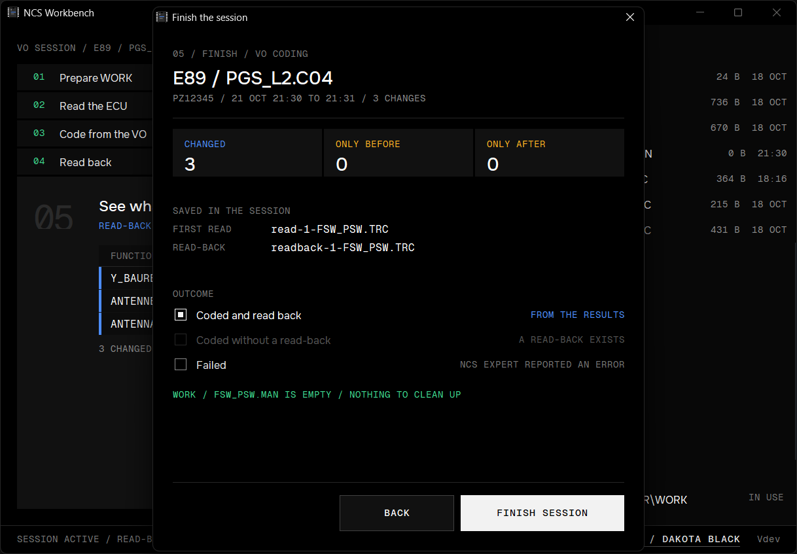

A summary of the session, the two reads it saved, and the outcome. The outcome is picked from the evidence, and you can't pick one that contradicts it:

| Outcome | Allowed when |
|---|---|
| **Coded and read back** | There's a read-back. |
| **Coded without a read-back** | There's no read-back. |
| **Failed** | Always, for example when NCS Expert reported an error. |

If `FSW_PSW.MAN` in WORK has something in it, **Empty FSW_PSW.MAN in WORK (saved first)** is offered and ticked. **FINISH SESSION** closes the session; **BACK** returns to it.

## History

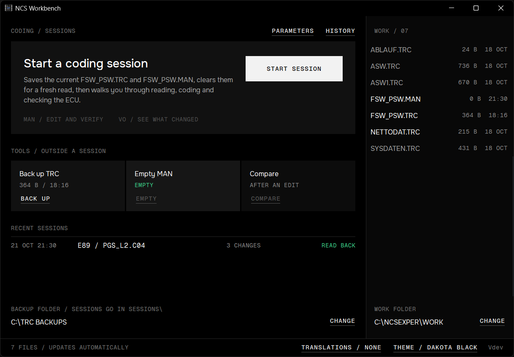

A finished VO session shows **READ BACK** (or **NOT READ BACK**) under **RECENT SESSIONS** and in **HISTORY**:

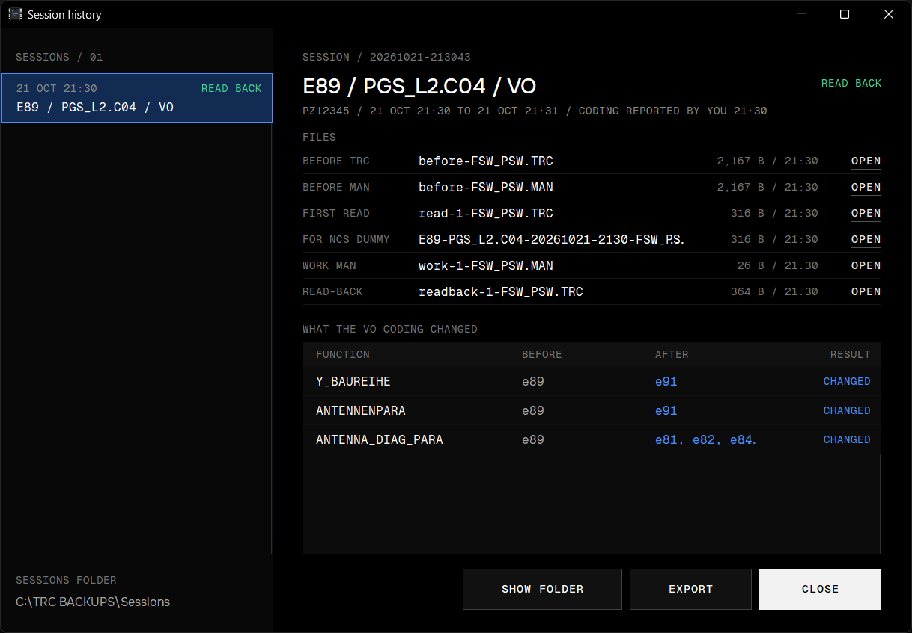

- **Files:** the TRC and MAN as they were before the session, the first read, the named copy, a MAN emptied during the session (**WORK MAN**) and the read-back. **OPEN** shows a file in Notepad.
- **What the VO coding changed:** each function with its value before and after, and **CHANGED**, **ONLY BEFORE** or **ONLY AFTER**.
- **SHOW FOLDER** and **EXPORT** work as for any session.

**CANCEL SESSION** and picking up after a crash work as in a MAN session: see [Cancel a session](guided-sessions.md#cancel-a-session) and [If Workbench closes mid-session](guided-sessions.md#if-workbench-closes-mid-session).

## What's saved

```
C:\TRC BACKUPS\Sessions\20261021-213043\
  session.ini                                 the record, with type=VO
  before-FSW_PSW.TRC, before-FSW_PSW.MAN      WORK as it was when the session started
  read-1-FSW_PSW.TRC                          the first read (read-2, ... after READ AGAIN)
  E89-PGS_L2.C04-20261021-2130-FSW_PSW.TRC    the named copy of the first read
  work-1-FSW_PSW.MAN                          a MAN saved by EMPTY MAN, a read-back or the finish
  readback-1-FSW_PSW.TRC                      each read-back
```

The copies are read-only. `session.ini` is plain text and opens in Notepad.
